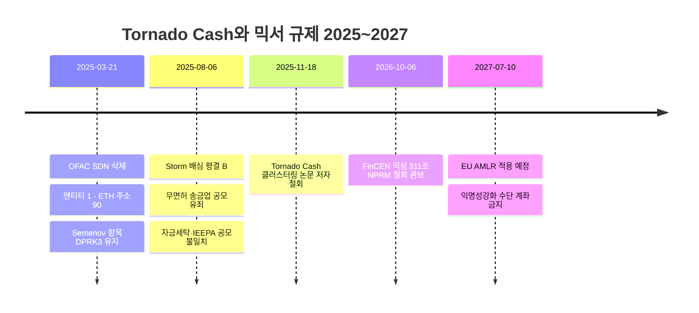
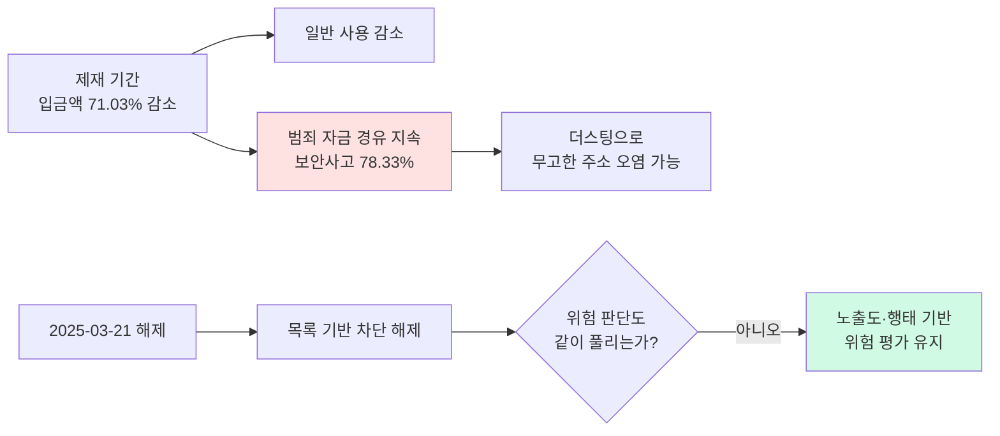

# Tornado Cash — DeFi 믹서 제재와 그 결말

> **코드를 제재할 수 있는가, 그리고 제재를 풀면 위험도 풀리는가?** 이 글을 읽고 나면 2025-03-21 OFAC 제재 해제, 2025-08-06 Roman Storm 배심 평결, 2026-10-06 미국 믹싱 제안규칙 철회가 하나의 흐름으로 연결되고, 왜 거래소가 "제재 해제 ≠ 위험 해제"로 운영해야 하는지를 학술 측정치로 설명할 수 있게 됩니다. 마지막 업데이트: 2026-10-21.

> **근거 범위**: `research/2026-10-*.md` 도시에와 정본 보고서에서 confidence A(일부 B, "(B)" 표시)로 확인된 사실만 쓴다. 이전 판의 2022년 지정 세부(자금 규모·주소 수·Circle 동결액), 항소심 판결 세부, 네덜란드 판결 형량, 기소장·변론 전략·배심 선정·amicus 단체 목록, 시나리오별 "확률 추정", 거래소·벤더별 대응 표, DAXA 공동 가이드는 이 근거 자료로 확인되지 않아 삭제했다. Storm 재심 일정 보도와 Elliptic의 "100 ETH 풀 1/3 불법 출처" 수치는 C 등급이라 쓰지 않는다.

## TL;DR
- **2025-03-21**: 미 재무부가 Tornado Cash를 SDN에서 삭제 — **엔티티 1개·ETH 주소 90개**(주 1·대체 89). 재무부는 "DPRK에 이익이 되는 거래를 계속 면밀히 감시"한다고 밝혔고, 공동개발자 Roman Semenov 항목은 **[DPRK3]로 유지**
- **2025-08-06**: 뉴욕 연방배심이 Roman Storm에게 **무면허 송금업 운영 공모 유죄**, 자금세탁 공모·IEEPA 위반 공모는 **배심 불일치**(B)
- **학술 측정(WWW '26)**: 제재 후 957일간 입금액 **71.03% 감소**, 그러나 Ethereum 보안사고의 **78.33%** 가 여전히 Tornado Cash 경유
- **2026-10-06 관보**: FinCEN의 CVC 믹싱 §311 제안규칙(88 FR 72701) **withdrawn**. 같은 주 미국은 A7 네트워크라는 특정 "네트워크"를 겨냥한 특별조치를 냈다 — 유형 규제에서 네트워크 차단으로
- EU AMLR 제79조(익명성강화 수단 계좌 금지)는 **2027-07-10 적용 예정(enacted-not-in-force)**

---

## 타임라인 — 한눈에



2022년 최초 지정, 미국 항소심 판결, 네덜란드 형사 판결은 이 사건의 전사(前史)지만 이 저장소 근거 자료에서 일자·세부를 원문으로 확인하지 않았다 — **공개 근거 미확인**. 1차 원문(OFAC 지정 공고, 법원 판결문)을 직접 확인한 뒤 인용한다.

---

## 1. Tornado Cash란 — 기술부터

Tornado Cash는 이더리움 기반 **믹서 스마트컨트랙트**다. 사용자가 풀에 입금할 때 비밀값의 해시(commitment)를 남기고, 나중에 다른 주소로 출금할 때 영지식 증명으로 "풀에 입금한 적이 있다"는 사실만 증명한다. 온체인에서 입금 주소와 출금 주소의 직접 연결이 끊기는 구조다.

용어:
- **Mixer** — 여러 사용자 자금을 섞어 입출금 대응을 끊는 서비스
- **영지식 증명(ZKP)** — 어떤 사실을 안다는 것만 증명하고 그 내용은 숨기는 암호 기법
- **Immutable 컨트랙트** — 배포 후 수정·삭제할 수 없는 스마트컨트랙트

### "끊긴다"는 이분법은 폐기됐다

2026년 학계는 "추적 가능/불가능" 대신 **익명성이 얼마나 줄었는가**를 잰다.
- Railgun 측정: 출금의 **17.65%** 가 입금과 하나로 연결, 중위 익명성 손실 **3.42비트**([arXiv 2606.25926](https://arxiv.org/abs/2606.25926))
- Railgun·Hinkal unshield 186,356건: 공개 토큰 제약만으로 평균 익명성 집합 **40.1~59.0%** 축소([arXiv 2608.22987](https://arxiv.org/abs/2608.22987))
- Tornado Cash 믹싱 계정 연결 공격(LASC, IEEE TDSC 2026) — 초록에 수치 없음([BIT 서지](https://pure.bit.edu.cn/en/publications/unveiling-ethereum-mixing-services-using-enhanced-graph-structure/))
- Tornado Cash 크로스체인 클러스터링 논문(arXiv 2510.09433)은 2025-11-18 v3로 **저자 철회**("mistakes in the references") — **수치 인용 금지**

### 실무 포인트

믹서 노출 판단은 "믹서를 거쳤으니 추적 끝"이 아니다. 금액·시간·토큰 제약으로 익명성 집합이 크게 줄어드는 경우가 측정돼 있으므로, 고위험 케이스에서는 **믹서 너머 추적**을 시도할 근거가 있다(FATF 2021 가이던스 para 277~278 "extend beyond the immediate transaction").

---

## 2. 제재와 해제 — 원문으로 확인되는 것

### 2025-03-21 해제

OFAC 조치 목록은 이 날짜를 "Cyber-related Designation Removal; North Korea Designation Update and Removal"로 기록한다. 삭제된 것은 SDN 1건(TORNADO CASH)과 이더리움 디지털통화주소 90개(주 1·대체 89)다. 재무부는 "exercised [its] discretion to remove the economic sanctions against Tornado Cash"라고 하면서도 "continue to monitor closely any transactions that may benefit malicious cyber actors or the DPRK"라고 덧붙였다. 같은 날 **SEMENOV, Roman** 항목은 [CYBER2] 태그만 제거되고 **[DPRK3]로 유지**됐다([OFAC 2025-03-21](https://ofac.treasury.gov/recent-actions/20250321); [재무부 sb0057](https://home.treasury.gov/news/press-releases/sb0057)).

### 해제가 의미하는 것 / 의미하지 않는 것

**의미하는 것**
- Tornado Cash 엔티티와 ETH 주소 90개가 SDN에서 빠졌다 — 그 주소와의 상호작용 자체는 더 이상 OFAC 지정 대상과의 거래가 아니다

**의미하지 않는 것**
- 개인 지정이 풀린 것 — Semenov는 DPRK 관련 지정이 유지됐다
- 위험이 사라진 것 — 아래 §3의 측정치가 반대를 보여 준다
- 형사 책임이 끝난 것 — §4

해제의 법적 근거가 된 소송·판결의 세부는 이 저장소 근거 자료에서 확인하지 않았다(공개 근거 미확인).

### 실무 포인트

제재 해제는 **목록 변경**이다. 회사 정책이 "OFAC 목록 = 위험 판단"에 묶여 있다면 해제와 동시에 통제가 자동으로 풀린다. 목록 대조(제재 출구)와 위험 평가(AML 출구)를 분리해 두어야 한다.

---

## 3. 제재는 효과가 있었나 — 학술 측정

Liu 외(WWW '26)는 957일·Ethereum 블록 679만 개·거래 10.7억 건으로 제재 효과를 쟀다([arXiv 2507.11721](https://arxiv.org/abs/2507.11721)).

| 측정 | 결과 |
|---|---|
| 제재 후 입금액 | **71.03% 감소** |
| Ethereum 보안사고 중 Tornado Cash 경유 비중 | **78.33%** (여전히) |
| 저자가 든 구조적 한계 | 합의층·응용층에 걸친 단편적 검열, 난독화 서비스의 복잡성, **이진 제재 목록의 더스팅 공격 취약성** |

한계: Ethereum 단일 체인, "보안사고"의 정의는 초록에 없다.



### 실무 포인트

"이진 제재 목록의 더스팅 취약성"은 거래소 운영에 직접 걸린다. 누군가 소액을 Tornado 관련 주소에서 고객 주소로 보내면, 목록 대조만 하는 룰은 무고한 고객을 차단한다. **노출 방향(수신 vs 송신)·금액·고객 행위**를 같이 보는 룰이 필요하다.

---

## 4. Roman Storm 형사재판

2025-08-06 뉴욕 연방배심은 Roman Storm에게 다음과 같이 평결했다(B)([Willkie 2025-08-08](https://complianceconcourse.willkie.com/articles/tornado-cash-cofounder-convicted-for-conspiring-to-operate-an-unlicensed-money-transmitting-business/)).

| 공소사실 | 평결 |
|---|---|
| 무면허 송금업 운영 공모 | **유죄** |
| 자금세탁 공모(Count 1) | 배심 불일치 |
| IEEPA 위반 공모(Count 3) | 배심 불일치 |

공소장은 플랫폼의 불법 이용을 알면서 AML 통제를 구현하지 않았다고 주장했다 — 믹서 운영자의 모니터링 의무가 쟁점이었다. 선고, 불일치 2개 죄목의 재심 일정, 무죄판결 신청 결과는 이 저장소 근거 자료에서 A/B로 확인되지 않았다(재심 연기 보도는 C) — **공개 근거 미확인**.

### 의미

- 제재 해제(2025-03)와 형사 유죄(2025-08)는 **서로 다른 법적 트랙**이다. "코드는 제재 목록에서 빠졌지만 운영자는 송금업 규제로 유죄가 될 수 있다"는 것이 2026-10-21 기준 확인되는 사실의 전부다.
- 이전 판의 혐의별 법정형, 체포·기소일, 보석 조건, 변호인·검사 이름, 시나리오 확률표는 근거 자료에서 확인되지 않아 삭제했다.

### 실무 포인트 — DeFi·VASP 담당자 체크

1. 회사가 운영하거나 지원하는 프로토콜에서 **프런트엔드·릴레이어·거버넌스 중 무엇을 회사가 통제하는가**를 문서화한다. FATF 2021 가이던스는 "A DeFi application … is not a VASP"이지만 통제력·영향력을 가진 사람은 VASP가 될 수 있다고 한다(para 66–69). FATF 2026-07-21 DeFi 보고서는 통제 존재를 기능적으로 판정하라고 권고했다([FATF 2026-07-21](https://www.fatf-gafi.org/en/publications/Virtualassets/targeted-report-decentralised-finance-2026.html)).
2. 송금업 해당성 검토를 제재 검토와 별도로 한다 — Storm 유죄 죄목은 제재가 아니라 무면허 송금업 공모였다.

---

## 5. 다른 프라이버시 도구와 규제 방향

### 미국 — 믹서 "유형" 규제는 철회, 특정 "네트워크" 차단은 강화

- FinCEN은 2026-10-05 CVC 믹싱을 주요 자금세탁 우려로 지정하려던 §311 제안규칙(88 FR 72701, 2023)을 철회했다. 관보 공고는 2026-10-06, 사유는 "chilling effect on legitimate activity"와 "deregulatory agenda"다([Federal Register 2026-20429](https://public-inspection.federalregister.gov/2026-20429.pdf); [FinCEN](https://www.fincen.gov/news/news-releases/fincen-announces-withdrawals-proposed-digital-asset-related-rules)). 상태 **withdrawn**. 철회 공고의 RIN 표기(1506-AB47)는 원 제안규칙 RIN(1506-AB64)과 달라 공고 오기로 보이며, 식별은 88 FR 72701 인용으로 한다.
- 같은 주 FinCEN은 러시아 연계 **A7 네트워크** 하위대리인과의 자금이체를 금지하는 특별조치 NPRM(RIN 1506-AB77)을 냈다(관보 2026-10-05, **proposed**). 근거는 §311이 아니라 Combating Russian Money Laundering Act §9714다([Federal Register 2026-20371](https://public-inspection.federalregister.gov/2026-20371.pdf)). 상세는 [`major-enforcement.md`](major-enforcement.md).

### EU — 2027년부터 CASP의 익명성강화 수단 취급 금지

AMLR(2024/1624) 제79조①은 CASP가 "anonymity-enhancing coins"를 포함해 거래를 익명화·난독화하는 계좌를 보유하는 것을 금지하며 **2027-07-10부터 적용**된다(enacted-not-in-force)([EUR-Lex OJ L 2024/1624](https://eur-lex.europa.eu/legal-content/EN/TXT/PDF/?uri=OJ:L_202401624)).

### Railgun — 스크리닝을 내장한 프라이버시 프로토콜(B)

Railgun은 PPoI 스크리닝을 오프체인에서 수행하고 기본 리스트로 shield를 검사한다. 이더리움 브로드캐스터는 PPoI를 요구하지만 **사용자가 직접 제출하는 거래는 검사를 건너뛴다**(L2BEAT, B)([L2BEAT](https://l2beat.com/privacy/projects/railgun)). "스크리닝 내장"이 우회 불가능을 뜻하지 않는다는 사례다.

### FATF — 민간에 노출 평가 요구

7차 TU 권고 6-iv는 VASP가 브리지·믹서·크로스체인 노출을 평가하라고 한다([7차 TU PDF](https://www.fatf-gafi.org/content/dam/fatf-gafi/reports/7th-targeted-update-on-implementation-fatf-standards-vas-vasps-2026.pdf.coredownload.pdf)).

이전 판의 믹서별 운명 표(Blender·Sinbad·Wasabi·Samourai·JoinMarket·Cryptomixer의 제재·체포 일자)는 근거 자료에서 확인되지 않아 삭제했다(공개 근거 미확인).

---

## 6. 한국 시점

- 한국 법령에 "믹서 사용 = STR"이라는 규정은 없다. STR은 특금법 §4의 "의심되는 합당한 근거"에 대한 판단이고, 거래모니터링 체계는 FIU 고시 「자금세탁방지 업무규정」 제76~81조(2026-01-22 시행)가 정한다 — 이 조문에 "가상자산"이라는 단어는 나오지 않는다([법제처 DRF](https://www.law.go.kr/DRF/lawService.do?OC=test&target=admrul&ID=2100000267264&type=XML)).
- 이전 판의 "한국 4대 거래소 공통 Tornado 자동 거부", "DAXA 공동 정책 2025-04"는 공개 근거가 확인되지 않아 삭제했다.

### 실무 포인트

OFAC 해제를 이유로 사내 믹서 정책을 바꿀 때는, 바꾸는 근거가 **목록 변경**인지 **위험 평가 결과**인지를 정책 문서에 적는다. 위 §3 측정치는 위험 평가 쪽 근거가 해제 전과 크게 다르지 않음을 보여 준다.

---

## 7. 학습 포인트

```
- 제재 해제(2025-03-21)는 목록 변경 — Semenov DPRK 지정은 유지, 재무부 DPRK 감시 지속
- 형사 트랙은 별개 — Storm 무면허 송금업 공모 유죄(2025-08-06, B)
- 제재 효과 측정: 입금 71.03% 감소, 보안사고 78.33% 여전히 경유
- 이진 목록은 더스팅에 취약 — 노출 방향·금액·행위를 같이 본다
- 미국은 믹서 유형 규칙을 철회(2026-10-06)하고 특정 네트워크 차단으로 이동
- EU는 2027-07-10부터 익명성강화 수단 취급 금지
```

## 💼 실무 현장 (Industry Reality)

### 해제 전후 룰 구조 — 목록 출구와 위험 출구 분리

```python
def mixer_exposure_review(tx):
    # 1) 제재 출구 — 현행 공식 목록만. 해제된 주소는 여기서 빠진다
    if sanctions_list.contains(tx.counterparty):
        return "REJECT_AND_REPORT"
    # 2) 위험 출구 — 목록과 무관하게 유지. 임계값은 자사 튜닝(공개 기준 없음)
    exp = analytics.exposure(tx, category="mixer")
    if exp.direction == "inbound_dust":
        return "LOG_ONLY"            # 더스팅 의심: 고객 행위 아님
    if exp.direct and exp.amount >= TUNED_THRESHOLD:
        return "EDD"                 # 자금원천 확인
    if exp.indirect:
        return "ANALYST_REVIEW"      # 즉시 거래 너머 추적 (2021 para 277~278)
    return None
```

이전 판의 "5-hop 노출", "1-hop 10% 기준", "위험점수 +50", 거래소·벤더별 라벨 정책 표는 공개 근거가 없어 삭제했다.

### 자주 나오는 오해

- **"제재 해제됐으니 믹서 노출은 저위험"** — 해제 후에도 Ethereum 보안사고의 78.33%가 Tornado를 경유했다는 측정이 있다.
- **"목록 대조만 하면 안전"** — 이진 목록은 더스팅에 취약하다(Liu 외).
- **"코드 제재가 끝났으니 개발자 리스크도 끝"** — Storm은 송금업 공모로 유죄 평결을 받았다(B).
- **"미국이 믹서 규칙을 철회했으니 규제 완화"** — 같은 주 특정 네트워크 차단 조치가 나왔다. 규제의 단위가 바뀐 것이다.

### 한국 특수 현실

- 한국 STR 판단 근거는 특금법 §4와 업무규정 제76~81조다. 해외 제재 목록 변경은 한국 STR 판단을 자동으로 바꾸지 않는다.
- 2027-07-10 EU AMLR 적용 이후 EU CASP와 거래하는 한국 VASP는 상대 CASP가 익명성강화 수단 관련 거래를 거절할 수 있음을 상대방 실사에 반영한다.

---

## 더 읽을거리
- [`lazarus-dprk.md`](lazarus-dprk.md) — DPRK와 Tornado Cash 해제의 관계
- [`major-enforcement.md`](major-enforcement.md) — 네트워크 단위 제재(A7·Huione)
- [`../3-crypto-aml/defi-nft-risks.md`](../3-crypto-aml/defi-nft-risks.md) — DeFi AML 회색지대
- [`../5-compliance/sanctions-screening.md`](../5-compliance/sanctions-screening.md) — OFAC 일반
- [OFAC Recent Actions 2025-03-21](https://ofac.treasury.gov/recent-actions/20250321)
- [Liu 외 — Evasion Under Blockchain Sanctions (WWW '26)](https://arxiv.org/abs/2507.11721)
- [Federal Register 2026-20429 — 믹싱 NPRM 철회](https://public-inspection.federalregister.gov/2026-20429.pdf)
- [Willkie — Storm 평결 요약 (2025-08-08)](https://complianceconcourse.willkie.com/articles/tornado-cash-cofounder-convicted-for-conspiring-to-operate-an-unlicensed-money-transmitting-business/)
