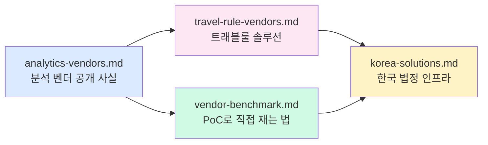

# 7️⃣ Vendors — 시장 지도

> 거래모니터링·트래블룰·한국 인프라 벤더를 **공개 사실과 선정 기준** 중심으로 정리한 폴더. 벤더 간 우열 평가는 하지 않고, 공개 근거가 없는 가격·점유율·성능 수치는 싣지 않습니다. 마지막 업데이트: 2026-10-21.

## 누가 먼저 읽어야 하나

- 🛒 **벤더 선정**을 주도하는 PM·보고책임자·컴플라이언스 책임자 (PoC 측정 방법 필요)
- 🏗️ 신규 VASP 신고를 준비하는 팀 (제도별로 어떤 기능이 필요한가)
- 📈 리서처 — 벤더에 관해 1차 자료로 확인되는 것과 아닌 것의 경계

## 읽는 순서

## 파일 인덱스

| # | 파일 | 다루는 것 | 핵심 판단 |
|---|---|---|---|
| 1 | [`analytics-vendors.md`](analytics-vendors.md) | 감독기관이 분석 도구에 기대하는 것, 1차 자료로 확인되는 벤더 사실 | 외주·자체 모두 허용(NYDFS). 판단 책임은 VASP |
| 2 | [`travel-rule-vendors.md`](travel-rule-vendors.md) | 컨소시엄 vs SaaS vs 분산형 트래블룰 솔루션 | 솔루션 네트워크 규모는 자사 주장 |
| 3 | [`korea-solutions.md`](korea-solutions.md) | 특금법·이용자보호법·통신사기피해환급법이 요구하는 시스템, 2025~2027 일정 | 제도 → 기능 → 담당으로 지도를 그린다 |
| 4 | [`vendor-benchmark.md`](vendor-benchmark.md) | 공개 벤치마크의 부재, PoC 설계·지표·측정 코드 | 비교는 우리 데이터로 잰 결과로만 |

## 핵심 출구

- "KYT"는 규제 용어가 아니다 — 감독 문서는 transaction monitoring / 거래모니터링체계(업무규정 제76~81조)
- FATF 7차 TU(2026-07-16): "transactions monitoring and blockchain analytics tools"로 급속 이전 탐지
- 벤더 공개 수치(커버리지·지연·라벨 수)는 T5 — 정의가 달라 비교 불가
- 가상자산 전용 alert-to-STR 벤치마크는 없다(B). 은행권 EY 2018 리테일 평균 14%만 공개

## 가격에 대해

이전 판의 "가격 감각"(KYT 소규모 $30K~$80K 등, 트래블룰 트랜잭션당 단가)은 출처가 없어 삭제했습니다. 계약 가격은 공개되지 않으며, 이 저장소는 검증된 가격 수치를 갖고 있지 않습니다.

## 다음 단계

- 거래모니터링 흐름과 산출물 3축 → [`../4-technology/kyc-kyt.md`](../4-technology/kyc-kyt.md)
- 기술 원리 → [`../4-technology/blockchain-analytics.md`](../4-technology/blockchain-analytics.md)
- 메시징 프로토콜 → [`../4-technology/travel-rule-protocols.md`](../4-technology/travel-rule-protocols.md)
- 한국 규제 맥락 → [`../2-regulations/korea-fiu-act.md`](../2-regulations/korea-fiu-act.md)
- 상위 인덱스 → [`../README.md`](../README.md)
