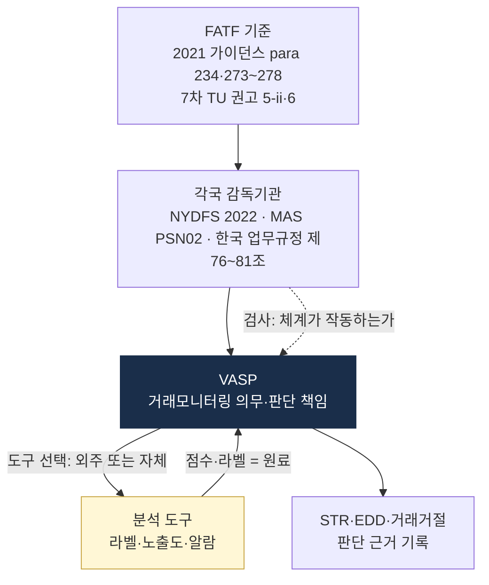

# Blockchain Analytics 벤더 — 공개 사실과 선정 기준

> 블록체인 분석 벤더에 대해 **1차 자료로 확인되는 것**과 **확인되지 않는 것**을 가른 지도. 이 글을 읽고 나면 감독기관이 분석 도구에 무엇을 기대하는지, 벤더 마케팅 수치를 왜 그대로 쓰면 안 되는지, PoC에서 무엇을 직접 재야 하는지 판단할 수 있게 됩니다. 마지막 업데이트: 2026-10-21.

## TL;DR
- 감독기관은 "분석 벤더를 써라"가 아니라 **"transactions monitoring and blockchain analytics tools"로 의심 패턴·급속 이전을 탐지하라**(FATF 7차 TU, 2026-07-16)고 요구한다. 외주·자체 도구 모두 허용된다(NYDFS 2022-04-28).
- 1차 문서로 확인되는 벤더 사실은 적다: FATF 7차 TU의 MIVA 표 검증 데이터 제공(Chainalysis·TRM Labs), 6차 TU 데이터 제공(Chainalysis·Lukka·Merkle Science·TRM Labs), 한국 FIU의 2026년 "체이널리시스(가상자산 분석도구) 도입" 계획.
- 벤더가 공개한 커버리지·라벨 주소 수·노출도 홉 정의·응답 지연·고객 수는 모두 **자사 주장(T5)** 이고 정의가 서로 달라 비교할 수 없다.
- 이전 판의 가격대, ARR 추정, 한국 시장 점유율, "4대 거래소 다수 사용", 지역별 강점 서열은 **공개 근거가 없어 삭제**했다. 벤더 간 우열은 평가하지 않는다.

---

## 1. 감독기관이 분석 도구에 기대하는 것



| 문서 | 분석 도구에 관한 서술 | 출처 |
|---|---|---|
| FATF 2021 RBA 가이던스 para 234 | 감독기관·VASP가 블록체인 분석을 쓰되 **비용, 벤더별 자산 커버리지 한계, 프라이버시·데이터보호 영향**을 고려 | [FATF 2021](https://www.fatf-gafi.org/content/dam/fatf-gafi/guidance/Updated-Guidance-VA-VASP.pdf.coredownload.pdf) |
| 같은 문서 para 156(c)·212 | EDD 수단으로 블록체인 분석, 트래블룰 데이터 불일치 식별에 분석 도구 활용 | 같음 |
| 같은 문서 para 323(g) | 일본 JFSA가 VASP KPI로 "블록체인 분석 도구의 거래 모니터링·위험분석 사용 여부"를 수집 | 같음 |
| NYDFS 산업서한 (2022-04-28) | 지원 자산별 추적 절차, **외주·자체 도구 모두 허용**, 점수·등급 활용, 분석도구가 "may not be able to identify underlying owners" | [NYDFS](https://www.dfs.ny.gov/industry_guidance/industry_letters/il20220428_guidance_use_blockchain_analytics) |
| EBA ML/TF 위험요소 가이드라인 개정 (2024-01-16, CASP 편입) | "transaction monitoring tools and advanced analytics tools"(B) | [CMS 요약](https://cms.law/en/bih/legal-updates/new-eba-guidelines-to-manage-aml-risks-as-part-of-the-activities-of-crypto-asset-service-providers) |
| FATF 7차 TU (2026-07-16) 권고 6-ii·6-iv | "detect rapid transfer of VAs using transactions monitoring and blockchain analytics tools", 프로토콜·브리지·믹서·크로스체인 노출 평가 | [7차 TU PDF](https://www.fatf-gafi.org/content/dam/fatf-gafi/reports/7th-targeted-update-on-implementation-fatf-standards-vas-vasps-2026.pdf.coredownload.pdf) |

### 실무 포인트

감독기관이 보는 것은 "어느 벤더인가"가 아니라 **회사가 도구 출력을 어떻게 판단에 썼는가**입니다. 도구의 한계(커버리지·귀속 불확실성)를 위험평가 문서에 적어 두는 것이 FATF para 234와 NYDFS 서한이 요구하는 수준입니다.

---

## 2. 1차 자료로 확인되는 벤더 관련 사실 (2026-10-21 기준)

| 사실 | 출처 | 확신도 |
|---|---|---|
| FATF 7차 TU의 MIVA 표 검증 데이터 제공: Chainalysis, TRM Labs | [7차 TU 공식 페이지 Acknowledgements](https://www.fatf-gafi.org/content/dam/fatf-gafi/reports/7th-targeted-update-on-implementation-fatf-standards-vas-vasps-2026.pdf.coredownload.pdf) | A |
| FATF 6차 TU(2025-06-26) 데이터 제공: Chainalysis, Lukka, Merkle Science, TRM Labs | [6차 TU](https://www.fatf-gafi.org/content/dam/fatf-gafi/recommendations/2025-Targeted-Upate-VA-VASPs.pdf.coredownload.pdf) | A |
| 한국 FIU 「'26년 자금세탁방지 주요 업무 수행계획」(2026-02-05): "체이널리시스(가상자산 분석도구) 도입" — FIU 자체 도입 계획이며 거래소 채택과는 별개 | [금융위 2026-02-05](https://fsc.go.kr/no010101/86209) | A |
| 연례 범죄 통계: Chainalysis(2026-01-08) 2025년 불법 주소 수취액 "최소 1,540억 달러", TRM(2026-01-28) 1,580억 달러 — 분모·정의가 달라 비교 불가 | [Chainalysis](https://www.chainalysis.com/blog/2026-crypto-crime-report-introduction/); [TRM](https://www.trmlabs.com/reports-and-whitepapers/2026-crypto-crime-report) | B |
| Railgun PPoI 스크리닝의 기본 리스트는 Chainalysis sanctions API로 shield를 검사하며, 사용자 직접 제출 거래는 검사를 건너뛴다 | [L2BEAT Railgun](https://l2beat.com/privacy/projects/railgun) | B |
| GraphSense는 MIT 라이선스 오픈소스 분석 플랫폼으로 2026-10 기준 활발히 갱신 중 | [GitHub graphsense](https://github.com/graphsense) | B |

### 확인되지 않아 싣지 않는 것

| 항목 | 이유 |
|---|---|
| 벤더별 커버리지("N개 체인"), 라벨 주소 수, 고객 수, 응답 지연 | 벤더 자사 페이지(T5). 정의가 서로 달라 비교 불가 (보고서 부록 B #20) |
| 인수·투자 금액, 기업가치 | 보도 기반(T4, C) (부록 B #21) |
| 공공조달 단독계약과 입찰이의 | 판결 미확인, 벤더 간 분쟁 (부록 B #22) |
| AI 에이전트 정식 출시 여부, 스테이블코인 동결 누적액 | T4/T5 (부록 B #23) |
| 국내 개별 거래소의 분석 벤더·도입 연도 | T4, C (부록 B #24) |
| 이전 판의 "$24T+ 추적", "20억+ 라벨 주소", "30+ 네트워크(4사 중 최다)", "한국 오피스 보유", "지역별 강점(북미·유럽·러시아)" | 출처 없음 또는 벤더 자체 표기와도 불일치 |

---

## 3. 벤더 유형 — 기능으로 나누기

벤더명을 서열화하는 대신 **기능**으로 나눕니다. 한 벤더가 여러 기능을 제공하는 경우가 많습니다.

| 기능 | 하는 일 | 관련 규범 |
|---|---|---|
| 주소 스크리닝 | 입출금 주소를 제재·블랙리스트·위험 카테고리와 대조 | FATF 2021 para 273, 7차 TU 권고 5-ii "wallet screening, blacklisting" |
| 거래 모니터링 | 노출도·금액·속도 등 조건으로 알람 생성 | FATF 2021 para 275~278, 업무규정 제76~78조 |
| 조사·추적 | 자금 흐름 시각화, 크로스체인 추적 | 7차 TU 권고 6-iv |
| 상대 VASP 식별·실사 | 트래블룰 상대 실사 보조 | FATF 2021 para 196~199 |
| 오픈소스 분석 | 자체 클러스터링·태그팩 운영 | 자체 구축 시 참고(GraphSense) |

### 실무 포인트

거래모니터링 도구와 사기 탐지(FDS) 도구는 입력 데이터가 다릅니다. 거래모니터링은 온체인 주소·노출도, FDS는 접속·기기·입출금 패턴을 씁니다(fds 도시에 §1). 한 벤더가 두 영역을 다 판다고 해도 **산출물(STR / 임시조치)은 법적으로 분리**해야 합니다 — [`../4-technology/kyc-kyt.md`](../4-technology/kyc-kyt.md) §6 참조.

---

## 4. 벤더 선정 기준

| 기준 | 확인 방법 |
|---|---|
| **체인·자산 커버리지** | 벤더의 "N개 체인" 대신, 우리 상장 자산 목록을 주고 지원 여부를 자산 단위로 받는다 |
| **귀속 품질** | 같은 주소 샘플에 대한 라벨 일치율을 직접 잰다 (공개 벤치마크 없음) |
| **노출도 산정 방식** | 홉 깊이·가중치 정책을 문서로 요구한다. 공개한 벤더는 없으므로 계약 단계에서 확인 |
| **감사 가능성** | 알람 근거·룰 변경 이력·점수 이력 내보내기 (업무규정 제80조 5년 보존) |
| **API 가용성** | 계약서 SLA로 확인. 벤더 웹 수치는 인용하지 않는다 |
| **데이터 이관** | 해지 시 분석 이력 export 조항 |
| **프라이버시** | 고객 데이터를 벤더에 보내는 범위 (FATF 2021 para 234) |
| **국내 설비 요건** | 고유식별정보 처리 전산설비 국내 소재 요건(신고매뉴얼 2026-08-13)과의 정합 ([금융위 2026-08-13](https://www.fsc.go.kr/no010101/87521)) |

---

## 5. PoC (Proof of Concept) 체크리스트

```
□ 우리 거래소 입출금 주소 샘플의 귀속 결과 비교 (벤더 간 일치율)
□ 알려진 위험 주소(제재·도난·스캠) 샘플의 탐지 여부
□ 같은 주소를 시간차로 재조회했을 때 점수 변동과 사유
□ 브리지 경유 거래의 추적 가능 범위
□ API 응답 시간 실측 (우리 네트워크 환경에서)
□ 알람 근거 export 형식 (STR 작성·검사 대응용)
□ 제재 목록 갱신 반영 주기
□ 데이터 이관 조건
```

### 실무 포인트

PoC에서 가장 중요한 건 **같은 주소를 여러 벤더에 넣어 결과를 비교**하는 것입니다. 벤더 광고 수치가 아니라 우리 고객·거래 환경에서의 결과가 기준이고, 그 측정 기록 자체가 위험평가 문서의 근거가 됩니다. 측정 방법은 [`vendor-benchmark.md`](vendor-benchmark.md) §3 참조.

---

## 6. 자체 구축 vs 벤더

- **벤더의 강점**: 축적된 라벨 DB. 다만 라벨 정확도를 공개 검증한 자료는 없다.
- **자체 구축의 강점**: 내부 KYC·원장과의 결합, 국내 사기 주소 등 자체 라벨. 오픈소스(GraphSense, MIT)를 출발점으로 쓸 수 있다.
- **한계는 같다**: 주소만으로 상대 VASP를 완전하게 식별하는 기술적 수단은 없다(FATF 2021 para 197(a)).

"한국 거래소 대부분이 하이브리드" 같은 일반화는 근거가 없어 삭제했습니다.

---

## 7. 2026 이후 확인된 흐름

- **규범 쪽**: FATF 7차 TU가 처음으로 "blockchain analytics tools"를 VASP 권고에 넣었다(2026-07-16). 브리지·믹서·크로스체인 노출 평가도 요구됐다.
- **발행자 동결의 한계**: 7차 TU는 범죄조직이 "immune to asset freezing"을 내세운 자체 스테이블코인을 발행한 사례를 들어 VASP가 "issuer-level asset freeze/burn mechanisms"에 기댈 수 없을 수도 있다고 경고했다(para 35). 학계는 USDT 제재 주소의 7.3%, USDC의 18.7%가 동결 발효 전에 전액 인출됐다고 측정했다([arXiv 2603.27739](https://arxiv.org/abs/2603.27739)). 분석 도구 쪽에서 "동결 가능 자산이니 안전" 가정을 두면 안 된다는 뜻이다.
- **프라이버시 프로토콜**: Tornado Cash는 2025-03-21 OFAC SDN에서 삭제됐지만(엔티티 1·ETH 주소 90)([OFAC](https://ofac.treasury.gov/recent-actions/20250321)), Roman Storm은 2025-08-06 무면허 송금업 공모로 유죄 평결을 받았다(B)([Willkie](https://complianceconcourse.willkie.com/articles/tornado-cash-cofounder-convicted-for-conspiring-to-operate-an-unlicensed-money-transmitting-business/)). 제재 해제가 위험 해제는 아니다.
- **연구 쪽**: 그래프 신경망의 실무 우위는 공개 근거로 확인되지 않는다. Elliptic 시계열 분할에서 Extra Trees AUPRC 0.570이 GraphSAGE 0.311을 앞섰다(B)([Akter 외 2026](https://publications.eai.eu/index.php/airo/article/download/13658/4313/36724)).

## 💼 실무 현장 (Industry Reality)

### PoC 운영 팁

- **샘플은 우리 데이터로**: 우리 거래소 입출금 주소, 우리가 STR 낸 사건의 주소, 알려진 제재 주소를 섞어 기준 집합을 만든다.
- **지표를 미리 정의**: 라벨 커버리지(Unknown 비율), 일치율, 위험 판정의 정밀도·재현율, 응답 시간. 정의를 먼저 문서화해야 벤더 간 비교가 공정하다.
- **계약 조항**: 데이터 export·이관, SLA 미달 시 조치, 고객 데이터 처리 범위.

이전 판의 가격 협상 수치(연 라이선스 금액대, 할인율), 4대 벤더 ARR 추정 표, 한국 시장 점유율, PoC 표본 수·지연 목표치는 출처가 없어 삭제했습니다.

### 자주 나오는 오해

- **"이 벤더를 안 쓰면 검사에서 불리하다"** — 감독 문서는 외주·자체 모두 허용한다(NYDFS). 검사는 체계의 작동을 본다.
- **"체인 수가 많을수록 좋다"** — 벤더별 "체인 수"는 정의(네트워크·자산·브리지 포함 여부)가 달라 비교 불가다.
- **"벤더 점수가 곧 판단"** — 점수 산정 방식은 비공개다. 판단과 근거 기록은 회사 책임이다.
- **"제재 해제된 믹서는 정상"** — Tornado Cash 해제 후에도 형사 절차는 별개로 진행됐다.

### 한국 특수 현실

- FIU가 2026년 분석도구 도입을 계획했다는 것은 감독 측 분석 역량이 올라간다는 뜻이다. 거래소의 거래모니터링 결과와 감독기관 분석이 비교될 수 있다.
- 2027-02-19부터 해외 VASP·자기수탁 지갑 대상 1천만원 이상 이전에 자체 의심거래 감시체계가 의무화된다(enacted-not-in-force). 상대 VASP 위험등급(저위험·동일인 한정·제한) 판정에 분석 도구 출력을 쓸 경우 그 근거를 남겨야 한다([감독규정 FIU 고시 제2026-2호](https://www.law.go.kr/DRF/lawService.do?OC=test&target=admrul&ID=2100000285986&type=XML)).

---

## 더 읽을거리
- [`vendor-benchmark.md`](vendor-benchmark.md) — 벤더 비교를 직접 재는 방법
- [`travel-rule-vendors.md`](travel-rule-vendors.md) — 트래블룰 솔루션
- [`korea-solutions.md`](korea-solutions.md) — 한국 시장 인프라
- [`../4-technology/kyc-kyt.md`](../4-technology/kyc-kyt.md) — 거래모니터링 흐름과 산출물 3축
- [`../4-technology/blockchain-analytics.md`](../4-technology/blockchain-analytics.md) — 기술적 기반
- [FATF 7차 Targeted Update (2026-07-16)](https://www.fatf-gafi.org/content/dam/fatf-gafi/reports/7th-targeted-update-on-implementation-fatf-standards-vas-vasps-2026.pdf.coredownload.pdf)
- [NYDFS 블록체인 분석 가이던스 (2022-04-28)](https://www.dfs.ny.gov/industry_guidance/industry_letters/il20220428_guidance_use_blockchain_analytics)
