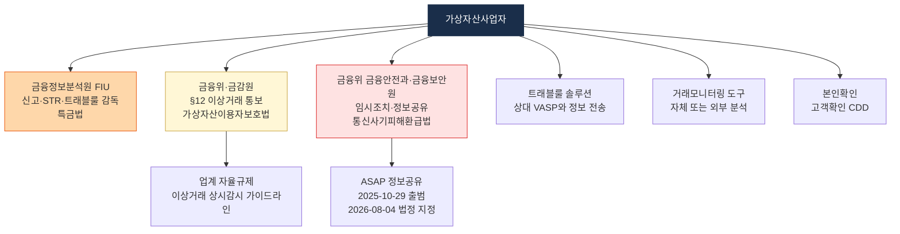
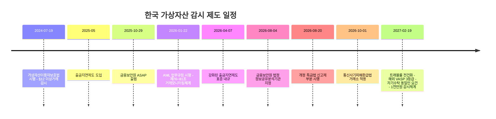

# 한국 시장 솔루션 지도

> 한국 가상자산사업자가 **법령상 연결해야 하는 인프라**와, 공개 자료로 확인되는 범위를 정리한 지도. 이 글을 읽고 나면 신규 VASP가 "어떤 제도에 어떤 시스템을 대응시켜야 하는가"를 그릴 수 있고, 업계 소문과 공개 사실을 구분할 수 있게 됩니다. 마지막 업데이트: 2026-10-21.

## TL;DR
- 한국 VASP의 시스템 요구는 **세 법률**에서 나온다: 특금법(AML·트래블룰·STR), 가상자산이용자보호법(§12 시장감시·기록 보존), 통신사기피해환급법(보이스피싱 임시조치, 거래소 적용 2026-10-01~).
- 신고매뉴얼(2026-08-13 전면 개정)은 **AML 업무 인력 4인 이상**, **고유식별정보 처리 전산설비 국내 소재(클라우드 국내 리전 인정)**, 대주주·법령준수체계 변경 **30일 전 사전신고**를 정했다.
- 트래블룰은 2026-10-21 현재 **100만원 이상**(in-force). 2027-02-19부터 **다른 VASP로의 모든 이전**으로 바뀐다(enacted-not-in-force).
- 이전 판의 벤더별 거래소 매칭(KYC·KYT·트래블룰), 수탁사 목록, 법무법인·컨설팅 목록, 연봉표, 연간 투자 규모, 신고 수리율, DAXA 공동 가이드 목록은 **공개 근거가 없어 삭제**했다.

---

## 1. 한국 VASP가 연결되는 법정 인프라



| 제도 | 시스템 요구 | 근거 |
|---|---|---|
| 특금법 신고 | AML 인력 4인 이상, 전산설비 국내 소재, 대주주 변경 사전신고 | [금융위 2026-08-13 신고매뉴얼](https://www.fsc.go.kr/no010101/87521) |
| 특금법 거래모니터링 | 업무규정 제76~81조 거래모니터링체계, 분석자료 5년 이상 보존 | [법제처 DRF 업무규정](https://www.law.go.kr/DRF/lawService.do?OC=test&target=admrul&ID=2100000267264&type=XML) |
| 특금법 트래블룰 | 시행령 §10-10: 현행 100만원 이상 → 2027-02-19 전건 | [법제처 DRF 시행예정 판본](https://www.law.go.kr/DRF/lawService.do?OC=test&target=eflaw&MST=288765&efYd=20270219&type=XML) |
| 이용자보호법 §12 | 이상거래 상시감시, 통보·신고. 상시감시·조치 결과 기록을 가상자산거래기록으로 보존(시행령 §13 6·7호) | [가상자산이용자보호법](https://www.law.go.kr/LSW/lsInfoR.do?lsiSeq=290735&efYd=20261002&ancYnChk=0&chrClsCd=010202&urlMode=lsInfoR); [시행령](https://www.law.go.kr/LSW/lsInfoR.do?lsiSeq=290171&efYd=20261002&ancYnChk=0&chrClsCd=010202&urlMode=lsInfoR) |
| 통신사기피해환급법 | 상시 자체점검, 임시조치(지연·일시정지), 거래목적 확인, 지급정지, 환급 | [통신사기피해환급법](https://www.law.go.kr/LSW/lsInfoR.do?lsiSeq=290245&efYd=20261002&ancYnChk=0&chrClsCd=010202&urlMode=lsInfoR) |

### 실무 포인트

"솔루션 지도"를 벤더 이름으로 그리면 금방 낡습니다. **제도 → 요구 기능 → 내부 담당**으로 그리고, 벤더는 그 기능을 채우는 교체 가능한 부품으로 두는 편이 검사 대응에도 유리합니다.

---

## 2. 2025~2027 한국 일정 — 시스템 변경이 필요한 날짜



근거: [금융위 2024-07-08](https://www.fsc.go.kr/no010101/82625), [금융위 2025-10-29](https://www.fsc.go.kr/no010101/85526), [금융위 2026-04](https://www.fsc.go.kr/po010102/86656)(출금지연, B), [금융위 2026-08-04](https://www.fsc.go.kr/no010101/87474), [금융위 2026-08-11](https://www.fsc.go.kr/no010101/87499), [금융위 2026-03-13](https://www.fsc.go.kr/no010101/86446). 감독규정 §28-2의 시행일은 기산점에 따라 2027-02-19 또는 02-21이 될 수 있어 확정되지 않았습니다.

---

## 3. KYC · 본인확인

한국 고객확인은 국내 본인확인 수단과 연동돼야 합니다. 글로벌 KYC 도구가 신분증 OCR·얼굴 매칭을 해도 국내 실명 확인을 대신하지는 못하므로 실무 구성은 "글로벌 도구 + 국내 본인확인" 조합이 됩니다.

이전 판의 "한국 거래소 대부분이 특정 KYC 벤더를 메인으로 사용" 같은 서술과 KYC 벤더 표는 공개 근거가 없어 삭제했습니다.

---

## 4. 거래모니터링 · 블록체인 분석

- 법적 근거는 가상자산 전용 조문이 아니라 금융권 공통 「자금세탁방지 업무규정」 제76~81조다(본문에 "가상자산" 0회).
- 2027-02-19부터 해외 VASP·자기수탁 지갑 대상 1천만원 이상 이전에 **자체 의심거래 감시체계**를 구축·운영해야 한다(시행령 §10-20 ⑦나, 고시 §28-2③). 자동 STR이 아니다.
- FIU 자체는 2026년 업무계획에 "체이널리시스(가상자산 분석도구) 도입"과 심사분석 AI 도입을 넣었다([금융위 2026-02-05](https://fsc.go.kr/no010101/86209)).
- 개별 거래소의 분석 벤더·도입 연도는 공개 1차 출처로 확인되지 않는다. 이전 판의 "글로벌 4사 모두 한국 진입·한국 사무소" 서술은 근거가 없어 삭제했다.

자세한 흐름은 [`../4-technology/kyc-kyt.md`](../4-technology/kyc-kyt.md).

---

## 5. 시장감시 (가상자산이용자보호법 §12)

2024-08-22 금융위·금감원 현장점검 기록에서 확인되는 것([금융위·금감원 2024-08-22](https://fsc.go.kr/po010101/82943)):

- 점검 기준: 법률과 **업계 자율규제인 「이상거래 상시감시 가이드라인」**
- 거래지원 부서와 분리된 전담 시장감시 조직
- 가격상승률·거래량증가율·최고가 변동폭 등 임계값 초과 시 적출하는 **자체 개발 분석시스템**
- 이용자 안내 → 거래유의 지정 → 주문·거래 제한 → 거래중단의 단계적 조치
- 금융당국과 5대 원화거래소 간 핫라인

집행 실적: 금융위는 2026-07-20 법 시행 2년 성과로 조사 완료 40여 건, 고발·통보 30여 건, 과징금 2건을 공표했다([금융위 2026-07-20](https://fsc.go.kr/po010106/87357)). 첫 과징금은 2025-09-03 테더마켓 자전거래 사건이다([금융위 2025-09-03](https://www.fsc.go.kr/po010101/85233)).

이전 판의 시장감시 벤더명 서술은 공개 근거가 없어 삭제했습니다.

---

## 6. FDS · 보이스피싱 대응

- **2026-10-01부터** 거래소는 통신사기피해환급법상 "금융회사등"이다. 상시 자체점검으로 피해의심거래계좌등이 추정되면 이체·출금·가상자산 이전을 지연·일시정지(임시조치)하고, 즉시 통지·본인확인 후 해당 없으면 해제해야 한다.
- **출금지연제도**: 2025-05 도입, 2026-04-07 강화된 표준 내규 시행. 근거 집계는 2025-06~09 거래소 사기이용계좌 2,526개 중 1,490개(59%)가 예외계좌였고 피해금의 75.5%가 예외계좌에서 유출됐다는 것이다(B)([금융위 2026-04](https://www.fsc.go.kr/po010102/86656)).
- **ASAP**: 금융보안원 정보공유 플랫폼(2025-10-29 출범, 약 130개 금융회사, 9개 유형·90개 항목). 2026-08-04 금융보안원이 법정 정보공유분석기관으로 지정됐다. 가상자산거래소의 실제 참여 여부는 공개 자료로 확인되지 않는다([금융위 2025-10-29](https://www.fsc.go.kr/no010101/85526); [금융위 2026-08-04](https://www.fsc.go.kr/no010101/87474)).

---

## 7. 트래블룰

- 2026-10-21 현재 시행령 §10-10 제1호는 **"1백만원 이상"**(in-force, 2027-02-18까지).
- 대통령령 제36592호(2026-08-18 공포)에 따라 2027-02-19부터 "다른 가상자산사업자에게 가상자산을 이전하는 모든 경우"로 바뀐다. 성명·주소는 이전과 동시에, 주민등록번호 등은 요청일부터 3영업일 이내 제공.
- 해외 VASP는 저위험 허용 / 그 외 고객·상대방 동일인일 때만 허용 / FATF 고위험국·무인허가 제한의 세 등급.
- 2026-10-01 금융위 실태조사: 2026년 상반기 **총 출고 62.8조원 중 트래블룰 적용 9.5조원(약 15%)**([금융위 2026-10-01](https://www.fsc.go.kr/no010101/87835)).

솔루션별 네트워크 규모는 자사 주장이라 싣지 않습니다(보고서 부록 B #25). 솔루션의 공개 사실은 [`travel-rule-vendors.md`](travel-rule-vendors.md).

---

## 8. 신고 요건 · 자율규제

- 신고매뉴얼(2026-08-13): AML 업무 인력 4인 이상(겸직 인정 가능), 전산설비 국내 소재, 대주주·법령준수체계 변경 30일 전 사전신고, 주요주주 기준(의결권주식 10% 이상 등) ([금융위 2026-08-13](https://www.fsc.go.kr/no010101/87521)).
- FIU는 2026-10-13 미신고 사업자 사이트 27건 접속차단을 공표했다(수사기관 통보 누적 44개)([금융위 2026-10-13](https://www.fsc.go.kr/no010101/87916)).
- 자율규제: 2024-08-22 점검 기록이 업계 자율규제 「이상거래 상시감시 가이드라인」을 점검 기준으로 명시했다. 출금지연제도도 금융위·DAXA·거래소가 함께 운영한다.
- 기존 사업자 재신고 기한(보도상 2026-11-20)은 부칙 원문이 확인되지 않아 싣지 않는다(보고서 부록 B #9).

정보보호 인증 등 그 밖의 신고 요건은 [`../2-regulations/korea-fiu-act.md`](../2-regulations/korea-fiu-act.md)를 보세요.

이전 판 §12(DAXA 설립 연도, 가입 조건, 2024~2026 공동 가이드 목록, "탈퇴 = 생존 불가", "준 라이선스")는 공개 근거가 없어 삭제했습니다.

---

## 9. 인접 분야 — 스테이블코인

- FATF 7차 TU Annex A에서 한국은 **스테이블코인 발행자 등록·인가 요구 "No"**로 표시됐다(2026-02~06 자기보고)([7차 TU PDF](https://www.fatf-gafi.org/content/dam/fatf-gafi/reports/7th-targeted-update-on-implementation-fatf-standards-vas-vasps-2026.pdf.coredownload.pdf)).
- 한국 2단계 입법(디지털자산기본법·원화 스테이블코인)은 진행 상황이 T4·C 수준이라 싣지 않는다(보고서 부록 B #10).
- 7차 TU는 VASP가 발행자 동결·소각에 기댈 수 없을 수도 있다고 경고했다(para 35). 스테이블코인을 다루는 거래모니터링은 "동결 가능하니 안전" 가정을 두지 않아야 한다.

---

## 10. 한국 시장 진입 시 점검표

```
□ 특금법 신고 (신고매뉴얼 2026-08-13 기준 요건)
□ AML 업무 인력 4인 이상, 보고책임자 지정
□ 고유식별정보 처리 전산설비 국내 소재
□ 거래모니터링체계 (업무규정 제76~81조) + 분석자료 5년 이상 보존
□ 트래블룰: 현행 100만원 이상 → 2027-02-19 전건화 대비
□ 해외 VASP 3등급 분류·자기수탁 동일인 확인 절차 (2027-02-19~)
□ 1천만원 이상 해외 VASP·자기수탁 이전 자체 감시체계 (2027-02-19~)
□ 거래소라면 §12 상시감시 조직·시스템, 통보 절차, 기록 보존
□ 거래소라면 통신사기피해환급법 임시조치·통지·해제·기록 절차 (2026-10-01~)
□ 출금지연제도 내규 (2026-04-07 강화 기준)
```

## 💼 실무 현장 (Industry Reality)

### 신규 VASP의 순서

법령 요건에서 역산하면 순서는 이렇습니다.

1. **신고 요건 충족 설계**: 인력(4인 이상)·전산설비 위치·대주주 구조
2. **거래모니터링체계 문서화**: 룰 목록, 임계값 근거, 검토 절차, 보존 정책 (업무규정 제76~81조)
3. **트래블룰 연동**: 2027-02-19 전건화와 해외 VASP 등급 분류까지 감안해 설계
4. **거래소라면** 시장감시(§12)와 FDS 임시조치(통신사기피해환급법)를 **별도 출구**로 설계

이전 판의 12개월 로드맵 기간, 단계별 투자 규모(연 ₩25~40억), 벤더 계약 비용, 인력 연봉표, "실제 수리율 약 30%", 신규 VASP 성공·실패 사례, 은행 제휴 현황, 규제기관 출신 인력 이동 서술은 출처가 없어 삭제했습니다.

### 자주 나오는 오해

- **"KYT 벤더만 붙이면 거래모니터링 의무 끝"** — 업무규정은 절차·분석담당자·보고체제·보존까지 요구한다. 도구는 일부일 뿐이다.
- **"이상거래 감시 = AML"** — 이용자보호법 §12의 이상거래는 불공정거래 우려 거래다. 보이스피싱·자금세탁은 다른 법의 다른 출구로 간다.
- **"2027년부터 1천만원 이상은 자동 STR"** — 공포본은 "자체 의심거래 감시체계"다.
- **"트래블룰은 이미 전건 적용"** — 2026-10-21 현재는 100만원 이상이다. 전건화는 2027-02-19.

### 한국 특수 현실

- **한 신호, 세 출구**: 같은 "이상" 신호가 FDS 임시조치·시장감시 통보·STR로 갈라진다. 검사도 FIU·금감원·금융안전과로 나뉜다.
- **트래블룰 적용 범위의 실제 크기**: 2026년 상반기 출고의 약 15%만 트래블룰이 적용됐다. 2027-02-19 전건화 이후 처리량이 크게 늘어날 수 있다.

---

## 더 읽을거리
- [`analytics-vendors.md`](analytics-vendors.md) — 분석 벤더 공개 사실
- [`travel-rule-vendors.md`](travel-rule-vendors.md) — 트래블룰 벤더
- [`vendor-benchmark.md`](vendor-benchmark.md) — PoC 측정 방법
- [`../2-regulations/korea-fiu-act.md`](../2-regulations/korea-fiu-act.md) — 특금법
- [`../2-regulations/korea-user-protection.md`](../2-regulations/korea-user-protection.md) — 가상자산이용자보호법
- [`../4-technology/kyc-kyt.md`](../4-technology/kyc-kyt.md) — 산출물 3축
- [금융위 2026-08-13 신고매뉴얼 전면 개정](https://www.fsc.go.kr/no010101/87521)
