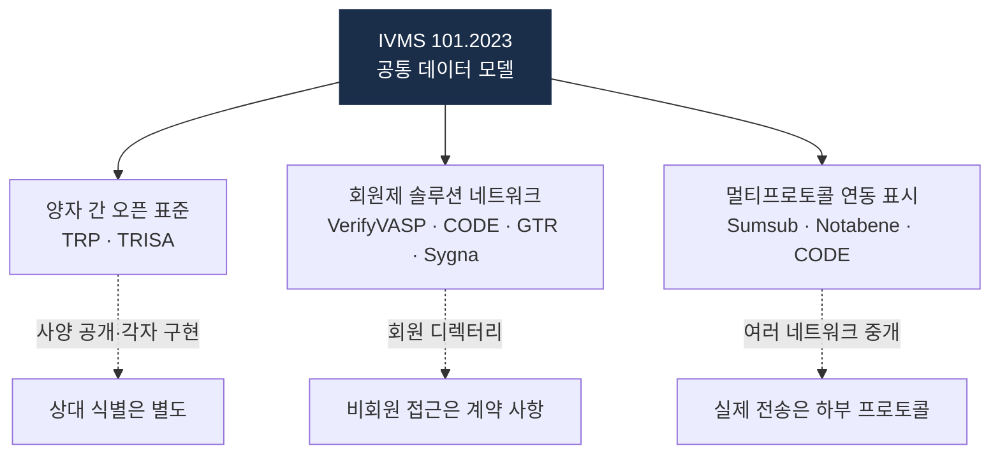
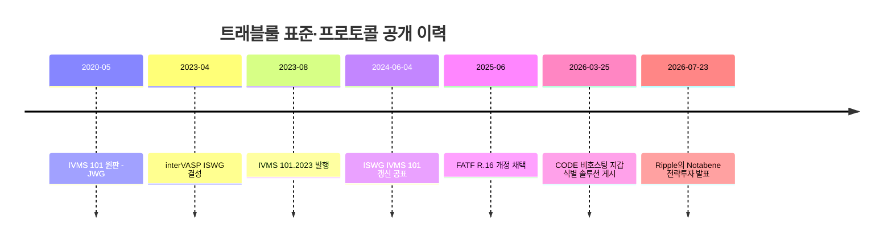
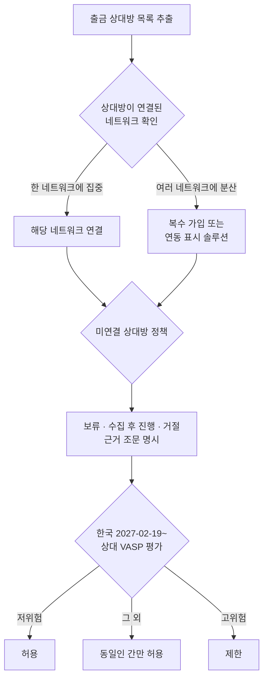

# Travel Rule 벤더 — 공개 사실 지도

> 메시징 프로토콜·Travel Rule 솔루션 시장을 **공개 자료로 확인되는 사실만** 정리합니다. 이 글을 읽고 나면 각 네트워크가 무엇이고 누가 운영하며 서로 어떻게 연동된다고 밝히는지, 그리고 무엇이 확인되지 않았는지를 구분할 수 있게 됩니다. 벤더 간 우열·추천·가격은 다루지 않습니다. 마지막 업데이트: 2026-10-21.

## TL;DR
- 모델은 셋: **양자 간 오픈 표준**(TRP·TRISA) · **회원제 솔루션 네트워크**(VerifyVASP·CODE·GTR·Sygna 등) · **멀티프로토콜 연동을 표시하는 솔루션**(Sumsub·Notabene·CODE 등)
- 2026-10-21 기준 정정: **OpenVASP Association 은 TRP 표준을 관리하는 협회**(이전 판의 "Ethereum·ENS·Whisper 기반"은 2020년 이전 설계), **GTR 운영 주체는 Infozone Technologies(싱가포르)**(이전 판의 "BitGo 등 컨소시엄"은 근거 없음), 데이터 모델 현행판은 **IVMS 101.2023**("IVMS101 v2" 없음)
- 네트워크 규모(VASP 수)·가격·성공률·가입 소요기간은 **공개 1차 근거가 없거나 자사 주장**이라 이 문서에서 뺐습니다
- 벤더 선택의 기준은 "누가 1위인가"가 아니라 **우리 출금 상대방이 어느 네트워크에 있는가**와 **미연결 상대방 정책**입니다

---

## 1. 시장 구조 — 3가지 모델



### 세 모델의 차이

- **양자 간 오픈 표준** — 사양이 공개돼 있고 각 VASP 가 구현합니다. TRP 는 "Bilateral exchange of encrypted data (VASP-to-VASP). No data or metadata is ever exchanged with any third party" 라고 설명합니다([OpenVASP TRP](https://www.openvasp.org/trp)).
- **회원제 솔루션 네트워크** — 운영자가 회원을 검증하고 디렉터리를 제공합니다.
- **멀티프로토콜 연동** — 한 솔루션이 여러 네트워크와의 연동을 표시합니다. 허브는 라우터이고, 실제 전송은 하부 프로토콜이 담당합니다.

---

## 2. 주요 벤더·프로토콜 — 공개 사실

아래는 2026-10-21 각 자사 페이지 열람 결과입니다(T3, 확신도 B). 네트워크 규모 수치는 자사 주장이라 인용하지 않습니다.

### A. Notabene

- 제품: SafeTransact·Notabene Flow·TAP. OpenVASP 회원. "Every Notabene customer has a live TRP 1.0 endpoint."
- 2026-07-23 Ripple 의 전략투자(금액 비공개) 발표
- 근거: [Notabene About](https://notabene.id/about-us), [Notabene TRP](https://notabene.id/travel-rule-messaging-protocols/trp), [Ripple 투자 발표](https://notabene.id/post/notabene-announces-strategic-investment-from-ripple)

### B. VerifyVASP

- 홈페이지에 TravelRule API·VerifyName API·VerifyWallet 제품 표시
- **운영 주체는 홈페이지에 명시되지 않음.** 이전 판의 "람다256 + Chainalysis 합작" 지분 구조는 2026-10-21 공개 1차 근거로 확인되지 않았습니다
- 근거: [VerifyVASP](https://www.verifyvasp.com/)

### C. CODE (CodeVASP)

- 운영: CODE Inc. 홈페이지 상호운용 목록에 CodeVASP·VerifyVASP·GTR·Sumsub·Sygna·Notabene·CryptoSwift 표시
- 2026-03-25 비호스팅 지갑 식별 솔루션 게시
- 이전 판의 "빗썸·코빗·코인원 3사 합작" 지분 구조는 홈페이지에서 확인되지 않음(2022 보도 기반으로만 전해짐)
- 근거: [CODE](https://www.codevasp.com/)

### D. Sumsub Travel Rule

- 자체·GTR·CODE·TRP·Sygna 5개 프로토콜 연동 표시. 비호스팅 지갑은 자체 프로토콜과 블록체인 분석 파트너를 통한 "multiple verification methods"로 검증한다고 적음
- 이전 판의 "본사 영국"은 이번 조사에서 확인하지 못해 삭제
- 근거: [Sumsub Protocols](https://sumsub.com/protocols/)

### E. Sygna (CoolBitX)

- Sygna Bridge 2.0·IVMS101 지원 표시. Sumsub·GTR·CODE 가 지원 프로토콜로 올림
- 이전 판의 "일본·동남아 거래소 다수"는 근거가 없어 삭제
- 근거: [Sygna](https://www.sygna.io/)

### F. Global Travel Rule (GTR)

- **운영: Infozone Technologies Pte. Ltd.(싱가포르)**. 홈페이지에 얼라이언스 회원 목록과 지원 프로토콜(Code·Sumsub·Sygna·Fireblocks), 제품(API·Manual·Wallet Verification·Out-Of-Network) 표시
- 이전 판의 "BitGo 등 컨소시엄, 일부 미국·중남미"는 근거가 없어 삭제
- 근거: [GTR](https://www.globaltravelrule.com/)

### G. TRISA

- gRPC/protobuf 기반 오픈소스 프로토콜 + Global Directory Service. 오픈소스 노드 **Envoy** 가 TRISA 와 TRP 를 모두 지원한다고 밝힘
- 2026-10-21 trisa.io 는 응답하지 않음 — 접속 불가만으로 운영 중단을 추정하지 말 것
- 이전 판의 "일부 LATAM, 신흥시장 사용"은 근거가 없어 삭제
- 근거: [trisa.dev](https://trisa.dev/), [GitHub trisacrypto/trisa](https://github.com/trisacrypto/trisa)

### H. TRP (Travel Rule Protocol) · OpenVASP

- **OpenVASP Association(Zug)이 TRP 표준을 관리**. 주간 TRP Working Group, GitLab 공개 사양(CC BY-SA 4.0), ISO 24165(DTI)·IVMS101 호환. TRP 벤더로 21 Analytics 등을 듦
- 현행 TRP 버전 번호는 사이트에 표시되지 않음
- 근거: [OpenVASP](https://www.openvasp.org/), [OpenVASP TRP](https://www.openvasp.org/trp), [GitLab](https://gitlab.com/OpenVASP/travel-rule-protocol)

### I. 21 Analytics

- 도메인을 21analytics.ch → 21analytics.co 로 이전(301). AOPP(주소 소유 증명 프로토콜) 용어집 운영
- 근거: [21 Analytics AOPP](https://21analytics.co/glossary/address-ownership-proof-protocol-aopp)

### 실무 포인트

위 사실은 모두 **자사가 자기에 대해 밝힌 것**입니다. 연동 목록은 "연동을 표시함"이지 품질·커버리지·안정성을 뜻하지 않습니다. 실제 도입 판단은 우리 출금 상대방 목록을 들고 각 네트워크에 직접 확인해야 합니다.

---

## 3. 벤더 선택 — 확인할 질문

이전 판의 "회사 유형별 추천" 표는 우열 평가여서 삭제했습니다. 대신 규범이 요구하는 것에서 출발한 질문 목록입니다.

| 질문 | 왜 필요한가 | 근거 |
|---|---|---|
| 우리 출금 상대방 상위 N 곳이 이 네트워크(또는 연동 네트워크)에 있는가 | 미연결이면 정보를 보낼 수 없음 | FATF 2021 para 200–201 (sunrise 대응) |
| IVMS 101.2023 의 C1·LEI 제약(C9~C11)을 검증하는가 | 현행 데이터 모델 제약 | [IVMS 101.2023](https://cdn.jsdelivr.net/npm/ivms101@2.0.0/specs/ivms101-2023.pdf) |
| 관할별 금액 구간을 **시점과 함께** 설정할 수 있는가 | 영국 1,000 euros(~2026-06-29) → £800(2026-06-30~) | [S.I. 2026/621](https://www.legislation.gov.uk/uksi/2026/621/made) |
| 한국 2027-02-19 전건화·요청 시 3영업일 추가정보를 지원하는가 | 금액 게이트 제거, 요청 응답 큐 | [시행령 §10-10 시행예정 판본](https://www.law.go.kr/DRF/lawService.do?OC=test&target=eflaw&MST=288765&efYd=20270219&type=XML) |
| 상대 VASP 실사 자료(인허가·트래블룰 이행)를 남길 수 있는가 | 한국 2027-02-19~ 고시 §28-2 등급 판정 | [감독규정 FIU 고시 제2026-2호](https://www.law.go.kr/DRF/lawService.do?OC=test&target=admrul&ID=2100000285986&type=XML) |
| 자기수탁 지갑 검증 방법은 무엇이고 어느 규범의 방법에 해당하는가 | EU 는 1종 이상 열거, 한국 2027 은 동일인 요건만 | [EBA/GL/2024/11](https://www.eba.europa.eu/sites/default/files/2024-07/6de6e9b9-0ed9-49cd-985d-c0834b5b4356/Travel%20Rule%20Guidelines.pdf) ¶83 |
| 메시지·판단 기록을 내보낼 수 있는가 | 벤더 교체 시 기록 보존 | — |

---

## 4. 통합 vs 분리

### Travel Rule + 거래모니터링 운영

```
KYC
  └─ Travel Rule 메시징
       └─ 거래모니터링 · 블록체인 분석
            └─ 내부 위험판단 엔진
```

FATF 7차 TU(2026-07-16)는 VASP 에 "transactions monitoring and blockchain analytics tools" 로 급속 이전을 탐지하라고 권고하지만, 이것은 트래블룰 메시징과 별개 통제입니다([7차 TU PDF](https://www.fatf-gafi.org/content/dam/fatf-gafi/reports/7th-targeted-update-on-implementation-fatf-standards-vas-vasps-2026.pdf.coredownload.pdf)). 이전 판의 "Chainalysis 는 VerifyVASP 합작을 통해 Travel Rule 제공", "TRM Travel Rule" 서술은 이번 조사에서 1차 확인되지 않아 뺐습니다.

### 실무 포인트

단일 벤더 통합은 편하지만 **벤더 종속**이 생깁니다. 어떤 구조든 메시지 원문·판단 근거·상대방 평가 기록을 자사 쪽에 보관해 두면 교체 비용이 줄어듭니다.

---

## 5. 한국 시장 운영 패턴

```
국내 VASP ↔ 국내 VASP
  ├─ ~2027-02-18: 100만원 이상만 정보제공 (in-force)
  └─ 2027-02-19~: 모든 이전 (enacted-not-in-force)
국내 VASP → 해외 VASP
  └─ 2027-02-19~: 저위험 허용 / 그 외 동일인 간만 / 고위험 제한 (고시 §28-2②)
국내 VASP → 자기수탁 주소
  └─ 2027-02-19~: 동일인 간만 허용, 위험 현저하면 제한 (고시 §28-2④)
```

2026 상반기 총 출고 62.8조원 중 트래블룰 적용은 9.5조원(약 15%)이었습니다([금융위 2026-10-01](https://www.fsc.go.kr/no010101/87835)). 국내 사업자 간 메시지는 솔루션 네트워크를 통해 오가고, CODE 홈페이지는 VerifyVASP 를 상호운용 목록에 올리고 있습니다(B). 거래소별로 어느 네트워크를 쓰는지는 이 저장소가 1차 근거로 확인하지 않았습니다.

### 실무 포인트

2027-02-19 이후 해외 VASP 허용 여부는 메시지 연결뿐 아니라 **상대 VASP 평가 결과**로 갈립니다. 벤더가 연결을 제공해도 평가가 "그 외" 등급이면 동일인 이전만 허용됩니다.

---

## 6. POC 체크리스트

```
□ 우리 출금 상대방 목록 기준 연결 여부 실측
□ IVMS 101.2023 검증 (PayloadVersionCode 101/101.2023, C1, LEI)
□ 응답 시간 — 자사 실측 (공개 SLA 벤치마크 없음)
□ 미연결 상대방 정책 설정 (보류·수집 후 진행·거절)
□ 관할별 금액 구간의 유효기간 설정 (영국 2026-06-30 전환 등)
□ 한국 2027-02-19: 금액 게이트 해제, 요청 시 3영업일 응답
□ 상대 VASP 평가 자료 보관
□ 메시지 보존 — 관할별 기록보존 조문으로 기간 확인
□ 개인정보 암호화, 국외이전 근거
□ 기록 export 조항
```

---

## 7. 가격

이전 판의 가격 참고치(연 $20K~$1M+, 거래당 ~$0.10)는 출처가 없어 삭제했습니다. 가격은 공개되지 않으므로 견적으로만 확인할 수 있습니다.

---

## 8. 2026-10-21 기준 변화와 남은 미확인

### 표준

- **IVMS 101.2023** 이 현행판(2023-08 발행, ISWG 2024-06-04 갱신 공표). "IVMS101 v2" 전망은 근거가 없습니다
- DTI(ISO 24165)는 TRP 가 호환을 명시, LEI(ISO 17442)는 IVMS 101.2023 제약 C9~C11

### FATF

- R.16 개정(2025-06 총회)은 VASP 에 R.15 를 거쳐 간접 적용, 이행 기대시한 2030-12-31
- R.16 이행 가이던스 초안 의견수렴 2026-06-24~2026-08-21, 2026-10-21 기준 최종본 미발간(proposed)
- 이전 판의 "2026 후반 가이던스 → 모든 벤더 업데이트", "2030 발효"는 각각 낡거나 부정확한 표현이라 고쳤습니다

### 미확인으로 남은 것

- 각 네트워크 회원 수·거래량 — 자사 주장만 있음
- VerifyVASP·CODE 지분 구조, 상호 연동 완료 시점
- 서명 표준(EIP-191/BIP-137) 사용 여부 등 자기수탁 검증 방식의 벤더별 세부



## 💼 실무 현장 (Industry Reality)

### 선택 흐름 — 우열이 아니라 상대방에서 출발



### 자주 나오는 오해

- **"Travel Rule 은 100만원 이상만"** — 한국 ~2027-02-18 기준입니다. 2027-02-19 부터 전건이고, EU TFR 은 처음부터 금액 무관 전건입니다
- **"개인지갑 출금은 Travel Rule 과 무관"** — 관할마다 다릅니다. EU 는 EUR 1,000 이상이면 자기수탁 주소 소유·통제 평가(TFR 제14조(5)·EBA GL ¶83), 영국은 reg 64G(정보 요청·미수령 시 지급 금지), 한국은 2027-02-19 부터 동일인 간만 허용(고시 §28-2④)
- **"외부지갑 등록제는 자율규제일 뿐"** — 2026-10-21 기준으로는 맞지만 2027-02-19 부터 동일인 요건이 고시 의무가 됩니다
- **"GTR 은 BitGo 컨소시엄"** — 운영 주체는 Infozone Technologies(싱가포르)입니다
- **"OpenVASP 는 Ethereum 기반 메시징"** — OpenVASP Association 은 TRP 를 관리하는 협회입니다
- **"FIU 에 트래블룰 실패율을 분기 보고한다"** — 그런 보고 의무의 근거 조문은 이 저장소가 확인하지 못했습니다

### 한국 특수 현실

- **2027-02-19 전환**: 정보제공 전건화, 추가정보 요청 시 3영업일, 해외 VASP 3등급, 자기수탁 동일인 요건, 1천만원 이상 자체 의심거래 감시체계가 같은 날 시작합니다(감독규정 §28-2 시행일은 기산점 문제로 미확정)
- **제재 현실**: 두나무 과태료 352억원(2025-11-06 결정)의 사유는 고객확인·거래제한·의심거래보고 위반이고 트래블룰은 포함되지 않았습니다([FIU 보도자료 KDI 미러](https://eiec.kdi.re.kr/policy/materialView.do?num=273166))
- 이전 판의 "연동 3개월 공백", "외부지갑 24h 홀드", "Notabene 한국 미진출", 거래소별 스택 표·평가, 가입 소요기간·할인율은 공개 근거가 없어 삭제했습니다

---

## 더 읽을거리
- [`analytics-vendors.md`](analytics-vendors.md) — KYT 벤더
- [`korea-solutions.md`](korea-solutions.md) — 한국 시장 솔루션
- [`../3-crypto-aml/travel-rule.md`](../3-crypto-aml/travel-rule.md) — Travel Rule 운영·관할 비교
- [`../4-technology/travel-rule-protocols.md`](../4-technology/travel-rule-protocols.md) — 프로토콜 기술
- [`../../research/2026-10-travel-rule.md`](../../research/2026-10-travel-rule.md) §4.11 — 벤더 사실 출처·확신도
- [OpenVASP — TRP](https://www.openvasp.org/trp)
- [interVASP](https://intervasp.org/)
- [trisa.dev](https://trisa.dev/)
- [GTR](https://www.globaltravelrule.com/)
- [CODE](https://www.codevasp.com/)
- [VerifyVASP](https://www.verifyvasp.com/)
