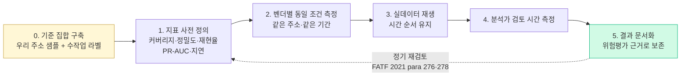

# 벤더 성능 비교 — 공개 수치가 없을 때 직접 재는 법

> AML 벤더 선정의 핵심은 "기능 비교"가 아니라 **우리 데이터로 잰 운영 지표 비교**입니다. 이 페이지는 이전 판의 "추정치 비교표"를 걷어내고, 2026-10-21 기준 공개 근거가 어디까지 있는지와 PoC로 직접 재는 방법을 정리합니다. 마지막 업데이트: 2026-10-21.

## ⚠️ 이 페이지를 고친 이유

이전 판(2026-04-23)은 "공개 정보·산업 보고서·실무자 인터뷰 기반 추정치"라며 벤더별 라벨 주소 수, 지원 체인 수, API p50/p99, FP rate(raw 70~85%·tuned 30~50%), 연간 비용, 시장 점유율, 한국 4대 거래소 채택 현황, "Behavior ML: Chainalysis Lynx GNN", 의사결정 매트릭스 점수, 트래블룰 연결 VASP 수·sunrise rate·메시지 지연, KYC 얼굴 인식 정확도·비용, 신규 VASP 초기 1년 비용(약 ₩500M)을 표로 실었습니다. **이 수치들은 전부 출처가 없었습니다.** kyt 도시에(2026-10-21) §9가 이를 확인했고, "Lynx GNN"은 공개 근거를 찾지 못했습니다. 모두 삭제했습니다.

## TL;DR

- **벤더 성능의 공개 벤치마크는 없다.** 라벨 정확도, 노출도 산정, 오탐률 모두 독립 검증된 공개 수치가 없다.
- 벤더가 자사 페이지에 쓴 커버리지·지연·고객 수는 **자사 주장(T5)** 이고 정의가 달라 서로 비교할 수 없다.
- 알람→SAR 전환율의 공개 수치는 **은행권 EY 2018(리테일 평균 14%)** 뿐이다. 가상자산 전용 alert-to-STR 벤치마크는 없다(B).
- "오탐 90~95%"는 정의가 통일되지 않은 2차 수치다.
- 결론: 벤더 비교는 **우리 데이터로 잰 PoC 결과**로만 한다.

## 1. 공개 근거가 있는 것과 없는 것

| 지표 | 공개 근거 | 2026-10-21 상태 |
|---|---|---|
| 라벨·귀속 정확도 | 없음 | 벤더 비공개. 학술 공개 데이터셋(Elliptic 등)은 벤더 라벨 정확도를 재는 용도가 아니다 |
| 노출도 홉 깊이·감쇠 | 없음 | 홉 상한·가중치를 공개한 벤더 없음 (kyt 도시에 §4.D) |
| 커버리지(체인·자산 수) | 벤더 자사 표기(T5) | "networks", "blockchains", "blockchains, bridges and tokens" 등 단위가 서로 달라 비교 불가 |
| API 지연·가용성 | 벤더 자사 표기(T5) | 계약 SLA로만 확인 |
| 오탐률(FP rate) | 없음 | 정의(알람 기준·건 기준)가 통일되지 않음 |
| 알람→SAR 전환율 | 은행권 EY 2018 (B) | 리테일 평균 14%, 마켓 0.2%, 2014 이래 개선 없음 ([EY 2018](https://ey.com/content/dam/ey-unified-site/ey-com/en-uk/industries/financial-services/documents/ey-anti-money-laundering-transaction-monitoring-2018-emeia-survey.pdf)) |
| 가상자산 alert-to-STR | 없음 | 존재하지 않는다(B) |
| 연간 비용 | 없음 | 계약 비공개 |
| 국내 거래소별 채택 벤더 | 없음 | 공개 1차 출처 미확보 (보고서 부록 B #24) |

### 학술 문헌이 말해 주는 것

벤더 비교는 아니지만, 모델 성능을 읽을 때의 주의점은 공개돼 있습니다.

- 극단적 불균형 데이터에서는 F1만 보면 오독한다. Elliptic2의 GLASS 모델은 F1 0.933이지만 PR-AUC는 0.208이다(B)([arXiv 2404.19109](https://arxiv.org/abs/2404.19109)).
- 시계열 분할에서 트리 앙상블이 GNN을 앞섰다: Extra Trees AUPRC 0.570 vs GraphSAGE 0.311(B)([Akter 외 2026](https://publications.eai.eu/index.php/airo/article/download/13658/4313/36724)).
- 템플릿 기반 이상 주입 벤치마크는 모델 강건성을 과대평가한다(TransXion, KDD '26)([arXiv 2604.17420](https://arxiv.org/abs/2604.17420)).

그래서 PoC 지표는 **정밀도·재현율·PR-AUC**처럼 불균형에 강한 것을 쓰고, 시간 순서를 지켜 평가해야 합니다.

## 2. PoC 설계 흐름



### 2.1 준비 — 기준 집합(ground truth)

- [ ] 우리 거래의 대표 샘플 추출 (기간을 명시)
- [ ] 위험 수준이 다양한 테스트 주소 선정: 제재 주소, 믹서 관련, 과거 STR 사건, 정상 거래소 주소, 판단이 애매한 주소
- [ ] 각 주소의 실제 위험 판정을 수작업 라벨링하고 라벨 근거를 기록
- [ ] 샘플 수와 구성 비율은 회사가 정하고 그 이유를 적는다 (공개 표준 없음)

### 2.2 지표 정의

- 라벨 커버리지: 조회 주소 중 "Unknown" 비율
- Precision = TP/(TP+FP), Recall = TP/(TP+FN), PR-AUC
- 응답 시간 p50/p95/p99 (우리 네트워크 환경 실측)
- API 오류율
- 벤더 간 판정 일치율
- 분석가 1건 처리 시간

### 2.3 측정 코드 예시

**라벨 커버리지**
```python
def test_coverage(vendor_api, test_addresses):
    unknown = 0
    for addr in test_addresses:
        r = vendor_api.query(addr)
        if r.category == "Unknown":
            unknown += 1
    return 1 - (unknown / len(test_addresses))
```

**정밀도·재현율**
```python
def test_accuracy(vendor_api, labeled_set):
    tp, fp, fn = 0, 0, 0
    for addr, truth in labeled_set:
        pred = vendor_api.query(addr).risk_level
        if truth == "risky" and pred == "risky": tp += 1
        elif truth == "safe" and pred == "risky": fp += 1
        elif truth == "risky" and pred == "safe": fn += 1
    p = tp / (tp + fp) if tp + fp else 0
    r = tp / (tp + fn) if tp + fn else 0
    f1 = 2 * p * r / (p + r) if p + r else 0
    return {"precision": p, "recall": r, "f1": f1}
```

**응답 시간**
```python
import time, statistics
def test_latency(vendor_api, addresses):
    times = []
    for addr in addresses:
        start = time.perf_counter()
        vendor_api.query(addr)
        times.append((time.perf_counter() - start) * 1000)
    return {
        "p50": statistics.median(times),
        "p95": statistics.quantiles(times, n=20)[18],
        "p99": statistics.quantiles(times, n=100)[98],
    }
```

### 2.4 실데이터 재생

- 실제 트래픽을 시간 순서대로 재생해 알람 수와 벤더 간 차이(같은 주소·다른 점수)를 기록
- 분석가 disposition 시간을 측정
- 과거 STR 사건이 알람으로 잡혔는지 확인

### 2.5 정성 평가·계약

- [ ] 문서·교육 자료, 분석가 사용성
- [ ] 알람 근거 export 형식 (업무규정 제80조 5년 보존과 정합)
- [ ] 데이터 이관·해지 조건
- [ ] 고객 데이터 전송 범위와 국내 설비 요건 (신고매뉴얼 2026-08-13: 고유식별정보 처리 전산설비 국내 소재) ([금융위 2026-08-13](https://www.fsc.go.kr/no010101/87521))

### 2.6 결과 템플릿

| 지표 | 벤더 A 실측 | 벤더 B 실측 | 벤더 C 실측 |
|---|---|---|---|
| 라벨 커버리지 | | | |
| Precision | | | |
| Recall | | | |
| PR-AUC | | | |
| 응답 시간 p50 / p99 | | | |
| API 오류율 | | | |
| 벤더 간 일치율 | | | |
| 분석가 처리 시간 | | | |
| 과거 STR 사건 포착 | | | |

가중치는 회사 위험평가에 따라 정합니다. 이전 판의 가중치 예시와 벤더별 점수(8.05 / 7.20 / 7.50)는 근거 없는 가상 점수라 삭제했습니다.

## 3. 트래블룰·KYC 벤더 비교에 대해

이전 판의 트래블룰 표(연결 VASP 수, 메시지 지연, sunrise rate, 비용)와 KYC 표(처리 속도, 얼굴 인식 정확도, 비용)는 출처가 없어 삭제했습니다. 트래블룰 솔루션의 공개 사실은 [`travel-rule-vendors.md`](travel-rule-vendors.md)를 보세요. 솔루션별 네트워크 규모는 자사 주장이라 보고서 본문에서도 제외됐습니다(부록 B #25).

트래블룰 PoC에서 잴 것:
- 상대 VASP 도달률(우리 실제 출금 상대 기준)
- 메시지 왕복 시간 실측
- 미도달(sunrise) 상대에 대한 처리 흐름 — 한국은 2027-02-19부터 해외 VASP 3등급 분류와 자기수탁 동일인 요건이 적용된다(enacted-not-in-force)

## 4. 주의 — 이 페이지의 한계

- 벤더 실측치는 이 저장소에 없다. PoC 결과는 회사 내부 자료다.
- 벤더 제품은 계속 바뀌므로 PoC 결과도 정기 재검토가 필요하다(FATF 2021 para 276·278의 룰 무결성·임계값 정기 검토와 같은 원리).
- 벤더 간 우열 평가는 하지 않는다.

## 💼 실무 현장 (Industry Reality)

### PoC에서 자주 하는 실수

- **벤더가 고른 샘플로 테스트**: 기준 집합은 반드시 우리가 만든다.
- **F1만 비교**: 불균형 데이터에서는 PR-AUC·재현율을 같이 본다.
- **시간 순서 무시**: 과거 라벨을 미래 거래 평가에 섞으면 성능이 부풀려진다.
- **측정 기록을 버림**: PoC 기록은 "왜 이 도구를 골랐나"를 감독기관에 설명할 근거다.

### 자주 나오는 오해

- **"업계 표준 FP율이 있다"** — 없다. 정의부터 다르다.
- **"벤더 비교표가 어딘가 공개돼 있다"** — 독립 검증된 비교표는 확인되지 않았다.
- **"무료 체험으로 충분히 비교된다"** — 체험 제공 여부·조건은 확인되지 않았다. 이전 판의 "3사 모두 30일 무료 체험"은 근거가 없어 삭제했다.

## 더 읽을거리

- [`analytics-vendors.md`](analytics-vendors.md) — 분석 벤더 공개 사실
- [`travel-rule-vendors.md`](travel-rule-vendors.md) — 트래블룰 벤더
- [`korea-solutions.md`](korea-solutions.md) — 한국 시장 인프라
- [`../4-technology/kyc-kyt.md`](../4-technology/kyc-kyt.md) — 거래모니터링 흐름
- [`../4-technology/blockchain-analytics.md`](../4-technology/blockchain-analytics.md) — 분석 기술 원리
- [EY 2018 EMEIA AML 거래모니터링 조사](https://ey.com/content/dam/ey-unified-site/ey-com/en-uk/industries/financial-services/documents/ey-anti-money-laundering-transaction-monitoring-2018-emeia-survey.pdf)
