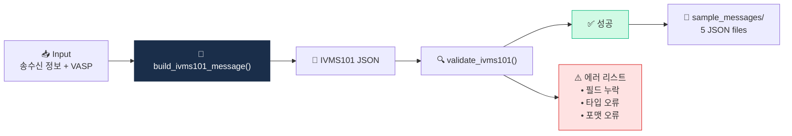
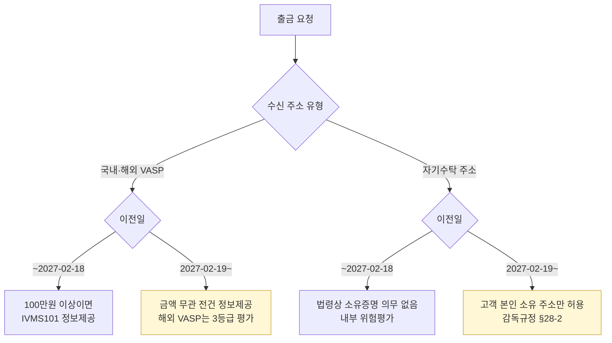

# Project 01 — IVMS101 메시지 빌더 + 검증

> Travel Rule 메시지 표준을 손으로 만들면서 체화. (D28 미니 프로젝트) 마지막 업데이트: 2026-10-21.


> **상태**: 스펙 작성 완료 (README.md만 존재, `main.py` 미작성 — 학습자 구현 대상)
> **위치**: `projects/01-ivms101-builder/` (예정: README.md + main.py + test.py + sample_messages/)
> **예상 구현 시간**: 주말 1일

## 🏗 아키텍처



## 왜 이걸 만드나

Travel Rule 이론을 여러 문서로 읽어도 **실제 IVMS101 메시지가 어떻게 생겼는지** 한 번도 만져보지 않으면 이해가 겉핥기로 남습니다. 이 프로젝트는 **한국 트래블룰 시나리오**(현행 시행령 §10의10 「100만원 이상」, 2027-02-19부터 기준금액 없이 전건)를 중심으로 Originator·Beneficiary·VASP 정보를 JSON으로 직접 생성하고 검증합니다. 필수 필드·타입·길이 제약을 손으로 처리해보면 **D22·D23에서 배운 내용**이 정확히 어디에 쓰이는지 몸에 새겨집니다.

## 학습 목표

1. IVMS101 JSON 스키마 구조 이해
2. 필수 vs 선택 필드 구분
3. 한국 시나리오 메시지 생성 — 2027-02-18까지(100만원 이상)와 2027-02-19부터(전건) 두 규칙을 날짜로 분기
4. 기본 검증 (필드 누락, 타입 오류) 함수
5. IVMS 101.2023 제약 C1(자연인 송신인 식별정보 택1 이상) 검증

## 사양

### 입력
- 송신인 정보 (이름, 주소, 지갑주소, DOB)
- 수신인 정보 (이름, 지갑주소)
- VASP 정보 (송수신측 LEI 또는 ID)
- 금액, 자산 종류

### 출력
- IVMS101 호환 JSON
- 검증 결과 (성공/실패 + 에러 리스트)

## 인터페이스

```python
def build_ivms101_message(
    originator: dict,
    beneficiary: dict,
    originating_vasp: dict,
    beneficiary_vasp: dict,
    amount: float,
    asset: str,
) -> dict:
    """IVMS101 호환 JSON 빌드"""

def validate_ivms101(msg: dict) -> tuple[bool, list[str]]:
    """필수 필드 + 타입 검증"""
```

## 테스트 케이스

1. **정상 한국 100만원 이상** — 필드 모두 채움
2. **송신인 이름 누락** — 검증 실패
3. **잘못된 wallet 형식** — 0x...가 아닌 ETH 주소
4. **비표준 통화 코드** — "BTCC" 같은 오타
5. **EU TFR 호환** — 금액 무관 전건 적용 시나리오(EU는 금액 기준이 없다)
6. **한국 50만원, 이전일 2027-02-18 vs 2027-02-19** — 앞은 시행령상 의무 대상 아님(대통령령 제36592호 부칙상 개정 규정 미시행), 뒤는 대상
7. **C1 위반** — 자연인 송신인에 주소·고객식별번호·국가식별번호·생년월일출생지가 모두 없음 → 실패

> 근거: 특금법 §5의3(가상자산 이전 시 정보제공), 시행령 §10의10 — 2027-02-18까지 「1백만원 이상」, 2027-02-19부터 "다른 가상자산사업자에게 가상자산을 이전하는 모든 경우"(대통령령 제36592호, 2026-08-18 공포, enacted-not-in-force)([법제처 DRF 시행예정 판본](https://www.law.go.kr/DRF/lawService.do?OC=test&target=eflaw&MST=288765&efYd=20270219&type=XML)). EU는 TFR(2023/1113) 2024-12-30 적용, "all crypto-asset transfers are subject to the same requirements regardless of their amount"([EBA/GL/2024/11](https://www.eba.europa.eu/sites/default/files/2024-07/6de6e9b9-0ed9-49cd-985d-c0834b5b4356/Travel%20Rule%20Guidelines.pdf)).

## 산출물

```
01_ivms101_builder/
├── README.md (이 파일)
├── main.py
├── test.py
├── requirements.txt
├── sample_messages/
│   ├── 01_korea_normal.json
│   ├── 02_originator_missing.json
│   ├── 03_invalid_wallet.json
│   ├── 04_invalid_currency.json
│   └── 05_eu_tfr.json
└── .env.example  # 사용 안 함, 빈 파일
```

## IVMS101 핵심 스키마 (빌더가 반드시 다뤄야 할 경로)

```
originator
 └─ originatorPersons[]
     └─ naturalPerson  (또는 legalPerson — 택일 discriminator)
         ├─ name
         │   └─ nameIdentifier[]
         │       ├─ primaryIdentifier      (성)
         │       ├─ secondaryIdentifier    (이름)
         │       └─ nameIdentifierType     (LEGL / BIRT / ALIA ...)
         ├─ geographicAddress[]
         │   ├─ addressType                (HOME / BIZZ ...)
         │   ├─ country                    (ISO 3166-1 alpha-2)
         │   └─ addressLine[]              (또는 streetName + buildingNumber)
         ├─ nationalIdentification
         │   ├─ nationalIdentifier
         │   ├─ nationalIdentifierType     (ARNU / DRLC / PASS ...)
         │   └─ countryOfIssue
         ├─ dateAndPlaceOfBirth
         │   ├─ dateOfBirth                (YYYY-MM-DD)
         │   ├─ placeOfBirth
         │   └─ countryOfBirth
         └─ countryOfResidence
 └─ accountNumber[]                         (보통 지갑주소)

beneficiary: originator와 동일 구조 (최소 필드는 완화 가능)

originatingVASP  / beneficiaryVASP
 └─ legalPerson
     ├─ name.nameIdentifier (LEGL)
     ├─ nationalIdentification  (LEI 권장, countryOfIssue 필수)
     └─ geographicAddress
```

### 검증 수준 (validate_ivms101이 잡아야 할 것)
1. **Discriminator**: `naturalPerson` XOR `legalPerson` (둘 다 있거나 없으면 오류)
2. **필수 필드**: `primaryIdentifier`, `country`(ISO-2), `accountNumber`, VASP `name` 존재
3. **제약 C1**: 자연인 송신인이면 geographicAddress(GEOG·HOME·BIZZ) **및/또는** customerIdentification **및/또는** nationalIdentification **및/또는** dateAndPlaceOfBirth 중 **1개 이상** 필수 — 각각은 선택이지만 넷 다 없으면 오류
4. **포맷**: `dateOfBirth` ISO 8601, `country` ISO 3166-1 alpha-2, LEI(ISO 17442) — LEI 관련 제약은 C9~C11
5. **문자열 길이**: 필드별 길이 제약은 IVMS 101.2023 원문으로 확인해 반영(이전 판의 "이름 100자, 주소 35자"는 원문 대조 전이라 삭제)

현행 데이터 모델은 **IVMS 101.2023**(interVASP ISWG가 2024-06-04 갱신 공표)이며, "IVMS101 v2"라는 판은 없습니다([interVASP](https://intervasp.org/); [IVMS 101.2023 PDF](https://cdn.jsdelivr.net/npm/ivms101@2.0.0/specs/ivms101-2023.pdf)). JSON Schema로 검증하려면 `jsonschema` 라이브러리에 원문 정의를 옮겨 쓰세요.

## 💼 실무 현장 (Industry Reality)

### 한국 출금 흐름에서 이 기능이 놓이는 자리



- **2027-02-18까지**: 시행령 §10의10 제1호 「1백만원 이상」 이전에 송신인·수신인 정보를 제공합니다. 자기수탁 주소와의 이전에는 법령상 소유증명 의무가 없습니다.
- **2027-02-19부터**: "다른 가상자산사업자에게 가상자산을 이전하는 모든 경우"로 바뀝니다. 성명·주소는 이전과 동시에, 주민등록번호 등은 요청을 받은 날부터 3영업일 이내에 제공합니다. 해외 VASP는 저위험 허용 / 그 외 동일인 간만 허용 / FATF 고위험국 소재·무인허가 제한의 세 등급으로 나뉘고, 자기수탁 주소("독점적인 관리 권한을 가지지 않은 가상자산주소")와의 이전은 동일인일 때만 허용됩니다. 1천만원 이상 거래에는 **자체 의심거래 감시체계**를 구축·운영해야 하며, 이것은 자동 STR 의무가 아닙니다(시행령 §10의20, FIU 고시 제2026-2호 §28-2)([감독규정 FIU 고시 제2026-2호](https://www.law.go.kr/DRF/lawService.do?OC=test&target=admrul&ID=2100000285986&type=XML); [금융위 2026-08-11](https://www.fsc.go.kr/no010101/87499)). §28-2의 정확한 시행일은 기산점 문제로 확정되지 않았습니다.
- 실제 적용 범위: 2026 상반기 실태조사에서 총 출고 62.8조원 가운데 트래블룰이 적용된 것은 9.5조원(약 15%)이었습니다([금융위 2026-10-01](https://www.fsc.go.kr/no010101/87835)).

### 프로덕션과의 차이

| 항목 | 학습용(이 프로젝트) | 실제 운영에서 추가로 필요한 것 |
|---|---|---|
| 메시지 생성 | Python dict → JSON | IVMS 101.2023 원문 제약 전체 검증 |
| 전송 | 파일 생성에서 끝 | 전송 프로토콜(TRP · TRISA · 솔루션 네트워크)과 인증 |
| 카운터파티 식별 | 수동 입력 | 상대 VASP 식별·실사 — FATF 2021 para 197(a)는 주소만으로 상대 VASP를 정확히 식별할 기술적 수단이 없다고 인정 |
| PII 보호 | 평문 JSON | 전송·저장 암호화 |
| 감사 로그 | 없음 | 송수신 기록 보존 — 기간은 특금법·이용자보호법 원문 확인, 겹치면 긴 쪽 |

### 전송 프로토콜·솔루션 (공개 사실만)

- **TRP** — OpenVASP Association이 관리하는 표준
- **TRISA** — 오픈 표준
- **솔루션 네트워크** — VerifyVASP · CODE · GTR(운영 주체 Infozone Technologies, 싱가포르) · Sygna 등. CODE 홈페이지는 VerifyVASP 등을 상호운용 목록에 올리고 있음
- 이전 판의 점유율 순위, 라이선스 가격, 지분·주주 구조, "한국 VASP 대부분이 X 사용" 서술은 공개 1차 근거가 없어 삭제했습니다([`../../notes/7-vendors/travel-rule-vendors.md`](../../notes/7-vendors/travel-rule-vendors.md)).

### 운영 지표

송신 성공률·round-trip 지연·수취인 이름 일치율 같은 업계 공개 벤치마크는 확인되지 않았습니다. 학습자가 자기 구현의 목표값을 정한다면 "본인 설정 목표"로 표시하세요. 이전 판의 성공률·지연·일치율·거절율 수치는 출처가 없어 삭제했습니다.

### 배포·운영 팁

- **본인확인 데이터 재사용**: 실명확인 결과로 `naturalPerson` 필드를 채울 때는 동의 범위에 트래블룰 제공이 포함됐는지 법무 검토가 필요합니다.
- **한국어 이름 로마자 표기**: 같은 성을 여러 로마자로 쓸 수 있어 수취인 일치 판정이 흔들립니다. 사내 표기 규칙을 고정하세요(영향 크기에 대한 공개 수치는 없음).
- **sunrise(상대 관할 미시행)**: FATF 2021 가이던스 para 200–201은 계약·사업관행으로 상대에게 준수를 요구하거나 내부이전·본인(first-party) 이전만 허용하는 대응을 제시합니다. EU는 sunrise 상대와의 거래를 금지하지 않고 "고위험 요소"로 분류합니다. 한국은 2027-02-19부터 해외 VASP 3등급으로 허용 여부를 법령화합니다.
- **자기수탁 지갑**: EU는 EUR 1,000 이상("amounts to or exceeds") 이전에서 자기수탁 주소의 소유·통제를 원격 온보딩 검증·소액 송금·메시지 서명 등 최소 1종으로 평가합니다(EBA/GL/2024/11 ¶83·¶86). 영국은 소유증명 의무 없이 정보 요청 후 미수령 시 지급 금지 구조이고, 심화정보 기준은 2026-06-30부터 £800입니다(S.I. 2026/621)([legislation.gov.uk](https://www.legislation.gov.uk/uksi/2026/621/made)). 한국은 2027-02-19부터 동일인 간만 허용(방법 미지정)입니다.

## 학습 자료

- [`../../notes/4-technology/travel-rule-protocols.md`](../../notes/4-technology/travel-rule-protocols.md) — IVMS101 deep
- [`../../notes/3-crypto-aml/travel-rule.md`](../../notes/3-crypto-aml/travel-rule.md) — Travel Rule 운영
- [IVMS 101.2023 PDF](https://cdn.jsdelivr.net/npm/ivms101@2.0.0/specs/ivms101-2023.pdf)
- [interVASP](https://intervasp.org/)

## 한계 / 주의

- **이 코드는 학습용**. 실제 Travel Rule 운영에는 인증서 + 전송 프로토콜 + 카운터파티 식별 등이 더 필요
- 이 프로젝트는 IVMS 101.2023의 단순화 버전 — 전체 제약은 원문 확인
- 프로덕션 환경에서는 검증된 전송 프로토콜·솔루션과 법무 검토가 필요

## 보너스 챌린지

- IVMS101 → ISO 20022 메시지 변환 (전통 금융 호환)
- 카운터파티 VASP Discovery (Mock)
- PII 암호화 (송신 전)
