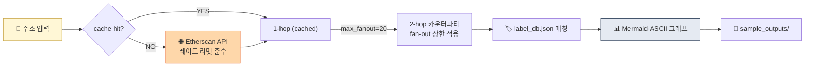
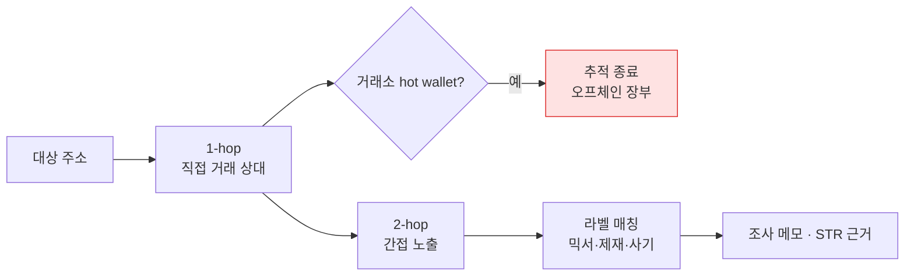

# Project 02 — Etherscan API 2-hop Tracer

> 직접 온체인 데이터로 자금 흐름 분석. (D35 미니 프로젝트) 마지막 업데이트: 2026-10-21.


> **상태**: 스펙 작성 완료 (README.md만 존재, `main.py` 미작성 — 학습자 구현 대상)
> **위치**: `projects/02-onchain-tracer/` (예정: README.md + main.py + test.py + sample_outputs/)
> **예상 구현 시간**: 주말 2일

## 🏗 아키텍처



## 왜 이걸 만드나

Chainalysis·TRM 같은 벤더의 UI로 이미 분석된 결과만 보다가 **직접 Etherscan API를 쳐서 트랜잭션을 긁어오는 경험**을 하면, KYT 벤더들이 해결하는 문제(속도·fan-out 폭발·rate limit·라벨링)를 몸으로 느낍니다. 1-hop은 간단하지만 2-hop부터 **요청 수가 제곱으로 폭발**하는 현실(1-hop 100명이면 2-hop 최대 100×100)이 벤더 가치를 체감시키는 순간. Week 5에서 배운 **Clustering·Attribution·Exposure**가 실무에서 어떻게 제약되는지의 교훈.

## 학습 목표

1. Etherscan API 사용 (무료 티어)
2. 1-hop / 2-hop 카운터파티 추출
3. 라벨 매칭 시도
4. 결과 시각화 (ASCII / Mermaid)

## 사양

### 입력
- Ethereum 주소 1개

### 출력
- 1-hop: 직접 거래 카운터파티 (이름/금액/시점)
- 2-hop: 1-hop 주소들의 추가 카운터파티
- 텍스트 그래프 또는 Mermaid 다이어그램

## 인터페이스

```python
def get_normal_txs(address: str, limit: int = 100) -> list[dict]:
    """주소의 normal transactions"""

def trace_one_hop(address: str) -> dict[str, dict]:
    """{counterparty: {tx_count, total_amount, last_tx}}"""

def trace_two_hop(address: str) -> dict[str, dict[str, dict]]:
    """{1-hop: {2-hop: {...}}}"""

def render_mermaid(graph: dict) -> str:
    """Mermaid 다이어그램 생성"""
```

## 테스트 주소 추천

공개로 알려진 주소 (학습용):
- Vitalik Buterin (0xd8dA6BF26964aF9D7eEd9e03E53415D37aA96045)
- Binance Hot Wallet (0x28C6c06298d514Db089934071355E5743bf21d60)
- Tornado Cash 1 ETH 풀 (0x12D66f87A04A9E220743712cE6d9bB1B5616B8Fc) — 2025-03-21 OFAC가 Tornado Cash 엔티티와 ETH 주소 90개를 SDN에서 삭제했으므로, 2026-10-21 기준 이 주소는 "제재 주소"가 아니라 "믹서" 라벨로 다룬다([OFAC 2025-03-21](https://ofac.treasury.gov/recent-actions/20250321))

## 산출물

```
02_onchain_tracer/
├── README.md
├── main.py
├── requirements.txt
├── data/
│   └── label_db.json  # 자체 라벨 DB
├── sample_outputs/
│   ├── trace_vitalik.md
│   └── trace_tornado.md
└── .env.example
```

## .env

```
ETHERSCAN_API_KEY=your_free_key  # https://etherscan.io/apis
```

## 💼 실무 현장 (Industry Reality)

### 이 기능의 규범적 근거

- FATF 2021 RBA 가이던스 para 277~278: 고위험 상황에서 모니터링을 "extend beyond the immediate transaction" — 간접 노출(2-hop 이상) 추적의 근거([FATF 2021 가이던스 미러](https://www.onpcsb.ro/2022/01042022/Updated-Guidance-VA-VASP.pdf))
- FATF 7차 TU(2026-07-16) 권고 6-ii·iv: "transactions monitoring and blockchain analytics tools"로 급속 이전 탐지, 브리지·믹서·크로스체인 노출 평가([7차 TU PDF](https://www.fatf-gafi.org/content/dam/fatf-gafi/reports/7th-targeted-update-on-implementation-fatf-standards-vas-vasps-2026.pdf.coredownload.pdf))
- NYDFS 산업서한(2022-04-28): 외주·자체 분석도구를 모두 허용하되 분석도구가 "may not be able to identify underlying owners"라는 귀속 한계를 인정([NYDFS](https://www.dfs.ny.gov/industry_guidance/industry_letters/il20220428_guidance_use_blockchain_analytics))



### 프로덕션과의 차이 (정성 비교)

| 항목 | 이 프로젝트(학습용) | 상용 조사 도구 |
|---|---|---|
| 데이터 소스 | Etherscan API 조회 | 자체 인덱싱·재처리 |
| 라벨 DB | 자체 수백 개 | 벤더 라벨(규모는 자사 주장, 미검증) |
| 휴리스틱 | 없음 | 클러스터링 등 — 정확도의 표준 공개 수치는 없음 |
| 다중 체인 | ETH만 | 크로스체인 추적 |

이전 판의 라벨 규모, 시트·라이선스 가격, 벤더별 강세 지역·정부계약·점유율 서술은 공개 1차 근거가 없어 삭제했습니다.

### 크로스체인 추적 — 공개된 학술 수치

브리지 양쪽 거래를 자동 매칭하는 연구가 2025년에 나왔습니다. ABCTracer는 12개 브리지 양방향 F1 91.75%, ConneX는 5개 브리지 약 50만 건 F1 0.9746을 보고했지만 브리지 집합이 달라 직접 비교할 수 없습니다([arXiv 2504.01822](https://arxiv.org/abs/2504.01822); [arXiv 2511.01393](https://arxiv.org/abs/2511.01393)). 이전 판의 "시간 오차 ≤ 수 분 자동 매칭", "6 hop 필수", "라벨 커버리지 70~90%", "렌더 <10초"는 출처가 없어 삭제했습니다.

### 배포·운영 팁

- **Fan-out 폭발 방지**: 1-hop fan-out을 `MAX_FANOUT = 20`처럼 제한하지 않으면 2-hop에서 호출 수가 제곱으로 늘어납니다. 인기 허브 주소는 강제 컷.
- **Hot wallet false lead**: 거래소 hot wallet에 닿으면 그 너머는 오프체인(거래소 내부 장부)입니다. 라벨 DB에 넣어 hop 확장을 멈추세요.
- **증거 보존**: 조회 시점 블록 높이와 원시 응답 JSON을 함께 저장하세요. 라벨 변경으로 같은 쿼리가 다른 결과를 낼 수 있습니다.
- **제재 해제 ≠ 위험 해제**: Tornado Cash 제재 후 957일 동안 입금액은 71.03% 줄었지만 Ethereum 보안사고의 78.33%는 여전히 Tornado Cash를 거쳤습니다(WWW '26)([arXiv 2507.11721](https://arxiv.org/abs/2507.11721)). 2025-03-21 SDN 삭제 이후에도 믹서 노출은 위험 신호로 남깁니다.

## 학습 자료

- [`../../notes/4-technology/blockchain-analytics.md`](../../notes/4-technology/blockchain-analytics.md) — Clustering + Attribution
- [Etherscan API 문서](https://docs.etherscan.io/)

## 한계 / 주의

- Etherscan 무료 티어 호출 한도는 [공식 문서](https://docs.etherscan.io/)로 확인 (한도는 바뀔 수 있음)
- **Fan-out 폭발 주의**: 1 ETH 주소 → 100개 거래 → 100명 카운터파티 → 2-hop 시 최대 100×100회 호출. 무보호 구현은 일일 한도를 금방 소진.
- **필수 가드** (구현에 반영):
  - `CACHE_DIR` 로컬 JSON 캐시 (같은 주소 재조회 금지)
  - `MAX_FANOUT` 상한 (예: 1-hop 20명, 2-hop 각각 10명으로 잘라내기)
  - `time.sleep()` 또는 token-bucket 레이트 리미터 (공식 한도보다 낮게 보수적 운영)
  - `tenacity` 기반 지수 백오프 (429/503 재시도)
  - 작은 카운터파티(예: < 0.01 ETH)는 프루닝
- ERC-20 token transfers는 별도 API endpoint (이 버전은 normal tx만)
- 한국 거래소 attribution은 한정적

## 보너스 챌린지

- ERC-20 token transfers 추가
- Risk Score 계산 (mixer/SDN exposure)
- Multi-chain (BSC, Polygon 추가)
- Visualization (graphviz, vis.js)
