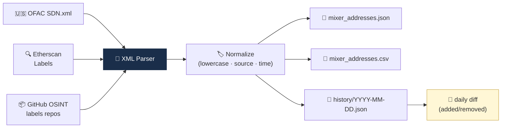
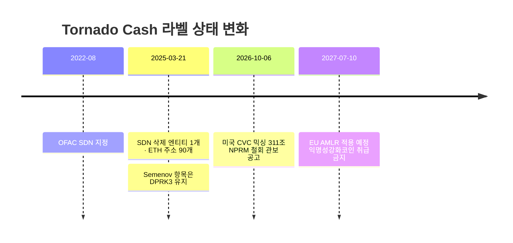

# Project 03 — Mixer 주소 공개소스 Fetcher

> 위험 wallet 데이터셋을 공개 소스에서 자동 수집. (D42 미니 프로젝트) 마지막 업데이트: 2026-10-21.


> **상태**: 스펙 작성 완료 (README.md만 존재, `main.py` 미작성 — 학습자 구현 대상)
> **위치**: `projects/03-mixer-fetcher/` (예정: README.md + main.py + test.py + data/)
> **예상 구현 시간**: 주말 1일

## 🏗 아키텍처



## 왜 이걸 만드나

"KYT 벤더의 진짜 경쟁력은 라벨 DB"라는 말을 **직접 체감**하는 프로젝트. OFAC SDN XML을 파싱하고 Etherscan 라벨을 긁어서 자체 mixer 데이터셋을 만들어보면, 왜 이 작업이 수년간의 축적이 필요한지 알게 됩니다(벤더가 공개하는 라벨 규모는 자사 주장이라 이 저장소는 인용하지 않습니다). Week 6의 **CMLN·mixer·OSINT** 지식이 코드로 응축되는 순간.

## 학습 목표

1. OFAC SDN XML 파싱
2. Etherscan label 데이터 활용
3. 표준 형식으로 저장 (JSON + CSV)
4. 일일 업데이트 + diff 추적

## 사양

### 입력
- 없음 (자동 fetch)

### 출력
- `data/mixer_addresses.json`
- `data/mixer_addresses.csv`
- 매 fetch 시 diff 로그

## 인터페이스

```python
def fetch_ofac_sdn() -> list[dict]:
    """OFAC SDN.xml → 가상자산 주소만 추출"""

def fetch_etherscan_label(label: str) -> list[str]:
    """Etherscan 라벨 페이지 (예: tornado-cash)"""

def normalize(addr: str, source: str, label: str) -> dict:
    return {
        "address": addr.lower(),
        "label": label,
        "source": source,
        "fetched_at": datetime.utcnow().isoformat(),
    }

def save_json(records: list[dict], path: str): ...
def save_csv(records: list[dict], path: str): ...

def diff_with_previous(current: list, prev: list) -> dict:
    """{added: [...], removed: [...]}"""
```

## 데이터 소스

### 1. OFAC SDN
- URL: https://www.treasury.gov/ofac/downloads/sdn.xml
- 가상자산 주소: `<feature><type>Digital Currency Address</type>...` 형태 (태그 구조는 [OFAC 데이터 포맷 문서](https://home.treasury.gov/policy-issues/financial-sanctions/specially-designated-nationals-list-data-formats-data-schemas)로 확인)
- 무료, 공개
- **주의 — 2026-10-21 기준 SDN에는 Tornado Cash가 없다**: OFAC는 2025-03-21 Tornado Cash 엔티티 1개와 ETH 주소 90개(주 1·대체 89)를 SDN에서 삭제했습니다. 같은 날 공동개발자 Roman Semenov 항목은 [DPRK3]로 유지됐습니다([OFAC 2025-03-21](https://ofac.treasury.gov/recent-actions/20250321)). 따라서 SDN 파싱만으로는 Tornado Cash 주소가 "mixer" 데이터셋에 들어오지 않습니다 — 라벨 출처(제재 vs 믹서)를 분리해 저장하세요.

### 2. Etherscan Label DB
- 페이지 스크래핑 (rate limit 주의)
- 예: `https://etherscan.io/accounts/label/tornado-cash`
- 공개 정보, robots.txt 준수

### 3. (선택) 추가 OSINT
- GitHub 라벨 저장소 (예: `0xVisor/labels`)
- Slowmist / 분석회사 공개 자료

## 산출물

```
03_mixer_fetcher/
├── README.md
├── main.py
├── requirements.txt
├── data/
│   ├── mixer_addresses.json
│   ├── mixer_addresses.csv
│   └── history/
│       └── YYYY-MM-DD.json  # 일별 스냅샷
└── .env.example
```

## 💼 실무 현장 (Industry Reality)

### 라벨 DB가 하는 일

라벨 DB는 거래모니터링·제재 스크리닝·사기 탐지·STR 작성이 공통으로 참조하는 데이터입니다. FATF 2021 RBA 가이던스 para 273은 블랙리스트 주소와 대조하라고 하고, para 234는 분석도구의 비용·자산 커버리지 한계를 지적합니다([FATF 2021 가이던스 미러](https://www.onpcsb.ro/2022/01042022/Updated-Guidance-VA-VASP.pdf)). 한국 거래소가 어떤 벤더 피드를 어떤 주기로 받는지, 거래소 간 공유 리스트의 구성·규모는 이 저장소가 1차 근거로 확인하지 않았습니다(이전 판의 "월 단위 피드 내재화", "원화거래소 5사 공유 피드" 서술은 삭제).

### 제재 라벨과 믹서 라벨은 다른 축이다



- 제재 라벨은 **목록 변경을 따라갑니다** — 해제되면 `removed`로 diff에 기록하고 차단 근거에서 뺍니다. 해제된 고객을 계속 막으면 민원·분쟁 사유가 됩니다.
- 믹서 라벨은 **위험 신호로 남습니다** — Tornado Cash 제재 후 957일 동안 입금액은 71.03% 줄었지만 Ethereum 보안사고의 78.33%는 여전히 Tornado Cash를 거쳤습니다(WWW '26)([arXiv 2507.11721](https://arxiv.org/abs/2507.11721)).
- 미국 FinCEN의 CVC 믹싱 §311 NPRM(88 FR 72701)은 2026-10-06 관보 공고로 철회(withdrawn)됐습니다([Federal Register 2026-20429](https://public-inspection.federalregister.gov/2026-20429.pdf)). EU AMLR(2024/1624) 제79조의 익명성강화코인 취급 금지는 2027-07-10 적용 예정(enacted-not-in-force)입니다([EUR-Lex](https://eur-lex.europa.eu/legal-content/EN/TXT/PDF/?uri=OJ:L_202401624)).

### 프로덕션과의 차이 (정성 비교)

| 항목 | 이 프로젝트(학습용) | 운영 DB에서 추가로 필요한 것 |
|---|---|---|
| 데이터 소스 | OFAC SDN + 공개 라벨 | 벤더 라벨 피드 + 자체 OSINT + 수사기관·피해 신고 연관 주소 |
| 카테고리 | "mixer" 단일 태그 | 제재·믹서·다크넷·사기·랜섬웨어 등 다중 분류 |
| 신뢰도 | 출처만 표시 | 라벨별 신뢰도와 근거 링크 |
| 버전 관리 | daily diff | 모든 변경 이력 + 검토자 기록 |

이전 판의 "수천만~수억 주소", 벤더 가격·강세 지역, KPI(커버리지 ≥60~80%, 반영 ≤1~4시간, 오라벨 월 10건, 정정 ≤5영업일)는 공개 근거가 없어 삭제했습니다. 학습자가 목표를 정한다면 "본인 설정 목표값"으로 표시하세요.

### 배포·운영 팁

- **라이선스 경계**: 벤더 라벨을 통째로 저장·재배포하는 것은 일반적으로 계약 위반 소지가 있습니다. 계약 조항을 확인하세요.
- **SDN 형식 변화**: SDN 파일 구조는 바뀔 수 있으므로 파서를 포맷 문서 기준으로 버전 관리하세요.
- **컨트랙트 vs 사용자 주소 구분**: 믹서 풀 컨트랙트 주소와 사용자 입출금 주소를 구분해 태그하세요.
- **감사 대비**: "이 주소가 왜 이 라벨인가"에 답할 수 있도록 **근거 URL + 태그 시점 + 태그 담당자**를 필수 필드로 보관하세요.

## 학습 자료

- [`../../notes/5-compliance/sanctions-screening.md`](../../notes/5-compliance/sanctions-screening.md) — 제재 스크리닝
- [`../../notes/3-crypto-aml/onchain-typology.md`](../../notes/3-crypto-aml/onchain-typology.md) — Mixer
- [OFAC SDN 다운로드](https://home.treasury.gov/policy-issues/financial-sanctions/specially-designated-nationals-list-data-formats-data-schemas)

## 한계 / 주의

- OFAC SDN은 예고 없이 수시로 갱신됨 — 고정 주기 가정 금지
- Etherscan 스크래핑은 약관 준수 필수
- 라벨 정확도는 출처에 따라 변동
- 가상자산 주소가 SDN에 포함되는 형식이 시간에 따라 변할 수 있음

## 보너스 챌린지

- 일일 cron job (GitHub Actions)
- Slack/Discord 알림 (신규 추가 시)
- 한국 외교부 제재명단 추가
- UN Consolidated List 추가 (이름 + 가상자산 매핑)
