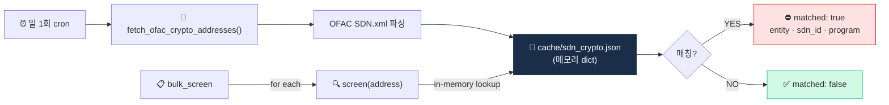
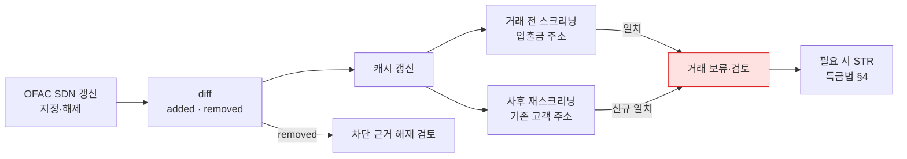

# Project 04 — OFAC SDN Crypto Wallet Screener

> 입력 주소가 OFAC SDN에 매칭되는지 자동 체크. (D49 미니 프로젝트) 마지막 업데이트: 2026-10-21.


> **상태**: 스펙 작성 완료 (README.md만 존재, `main.py` 미작성 — 학습자 구현 대상)
> **위치**: `projects/04-ofac-screener/` (예정: README.md + main.py + test.py + data/)
> **예상 구현 시간**: 주말 1일

## 🏗 아키텍처



## 왜 이걸 만드나

제재 스크리닝이 **왜 시스템 없이는 불가능한지** 체감하는 프로젝트. OFAC SDN은 수시 업데이트되고, SDN.xml 파싱·정규화·O(1) lookup·False Positive 처리 흐름까지 모두 자동화해야 실시간 거래 차단이 가능합니다. Week 7의 **제재 리스트·2차 제재·목록 변경(지정과 해제)** 이 왜 시스템 투자를 강제하는지 코드로 확인.

## 학습 목표

1. OFAC SDN crypto 주소 캐시 운영
2. 단일 / 벌크 스크리닝 함수
3. 매칭 결과 표준 응답
4. False positive disposition 흐름

## 사양

### 입력
- 가상자산 지갑주소 1개 또는 리스트

### 출력
```json
{
  "address": "0xABC...",
  "matched": true,
  "match_info": {
    "entity_name": "EXAMPLE ENTITY",
    "sdn_id": "00000",
    "programs": ["EXAMPLE"],
    "listed_date": "YYYY-MM-DD"
  }
}
```

> 위 값은 형식 예시(가상 값)입니다. 실제 엔티티명·ID·프로그램 태그는 SDN 파일에서 읽어 채웁니다.

## 인터페이스

```python
def fetch_ofac_crypto_addresses() -> dict[str, dict]:
    """OFAC SDN.xml → {address.lower(): metadata}"""

def screen(address: str) -> dict:
    """단일 주소 스크리닝"""

def bulk_screen(addresses: list[str]) -> list[dict]:
    """다수 주소 스크리닝"""

def refresh_cache() -> int:
    """캐시 강제 갱신, 신규 추가 수 반환"""
```

## 캐시 전략

- 최초 fetch → `cache/sdn_crypto.json`
- 일 1회 자동 갱신 (timestamp 기반)
- 메모리 dict로 O(1) lookup

## 테스트 케이스

1. 알려진 SDN 주소 (공개) → matched: true
2. 정상 wallet → matched: false
3. 대소문자 다양 (0xABC vs 0xabc) → matched (정규화)
4. 잘못된 형식 입력 → 에러 핸들링
5. 벌크 100개 → 빠른 응답
6. **해제된 주소** — 2025-03-21 SDN에서 삭제된 Tornado Cash ETH 주소 → matched: false, `delisted` 이력 표시 ([OFAC 2025-03-21](https://ofac.treasury.gov/recent-actions/20250321))

## 산출물

```
04_ofac_screener/
├── README.md
├── main.py
├── test.py
├── requirements.txt
├── cache/
│   └── sdn_crypto.json
└── .env.example
```

## 💼 실무 현장 (Industry Reality)

### 이 기능이 놓이는 자리



제재 스크리닝은 **이름(자연인·법인)** 과 **가상자산 주소** 두 차원으로 나뉘고, 이 프로젝트는 후자입니다. OFAC SDN은 지갑주소를 명시적으로 등재하므로 주소 스크리닝의 축이 됩니다. 이전 판의 "Binance·OKX·Bittrex·Kraken 합의금 대부분이 제재 스크리닝 실패에서 촉발" 서술과 금액은 이 저장소의 근거 자료로 확인되지 않아 삭제했습니다([`../../notes/6-cases/major-enforcement.md`](../../notes/6-cases/major-enforcement.md)).

### 2025~2026 제재 흐름 — 목록은 "유형"보다 "네트워크"를 겨냥

| 일자 | 조치 | 상태(2026-10-21) |
|---|---|---|
| 2025-03-21 | Tornado Cash SDN 삭제(엔티티 1·ETH 주소 90), Semenov [DPRK3] 유지 | 해제 완료 |
| 2025-10-14 | Prince Group 초국가범죄조직 지정(146개 대상), Huione Group §311 최종규칙 | in-force |
| 2026-09-17 | 이란 거래소 BitBank 등 E.O. 13902 지정("Operation Economic Outcast") | in-force |
| 2026-10-01 | A7 네트워크 TCO 지정(B) | in-force |
| 2026-10-06 | 믹싱 §311 NPRM·비수탁지갑 NPRM 철회 / A7 특별조치 NPRM | withdrawn / proposed |

출처: [OFAC 2025-03-21](https://ofac.treasury.gov/recent-actions/20250321), [재무부 sb0278](https://home.treasury.gov/news/press-releases/sb0278), [OFAC 2026-09-17](https://ofac.treasury.gov/recent-actions/20260917), [Federal Register 2026-20429](https://public-inspection.federalregister.gov/2026-20429.pdf), [Federal Register 2026-20371](https://public-inspection.federalregister.gov/2026-20371.pdf).

FATF 7차 TU(2026-07-16)는 통제 요소로 "KYC, wallet screening, blacklisting, and, where appropriate, whitelisting mechanisms as well as freezing and blocking capabilities"를 열거했습니다(권고 5-ii)([7차 TU PDF](https://www.fatf-gafi.org/content/dam/fatf-gafi/reports/7th-targeted-update-on-implementation-fatf-standards-vas-vasps-2026.pdf.coredownload.pdf)).

### 프로덕션과의 차이 (정성 비교)

| 항목 | 이 프로젝트(학습용) | 운영에서 추가로 필요한 것 |
|---|---|---|
| 스크리닝 대상 | 가상자산 주소만 | 이름·생년월일·국적 등 다차원 |
| 매칭 알고리즘 | 정확 일치 | 이름은 퍼지 매칭(로마자 이형 등) |
| 리스트 | OFAC SDN만 | OFAC · UN · EU · 영국 · 한국 외교부 등 + 내부 리스트 |
| FP 처리 | 없음 | 케이스 관리 → 검토 → 판정(TP/FP) 기록 |
| 감사 증거 | 없음 | 스크리닝 결과 보존 — 기간은 법령 원문 확인 |

### 운영 지표

매칭 지연(p95), 이름 매칭 FP 비율, 갱신 반영 시간, 판정 SLA에 대한 공개 업계 벤치마크는 확인되지 않았습니다. 이전 판의 지연·FP 비율·반영 시간·판정 SLA 수치와 벤더 가격은 출처가 없어 삭제했습니다. 미탐 0건은 목표로 둘 수 있지만 수치 기준이 아니라 원칙입니다.

### 배포·운영 팁

- **2차 제재**: OFAC는 SDN과 거래하는 제3자(미국 외 기업 포함)도 제재할 수 있습니다. 간접 연결은 cluster matching(보너스)로 다룹니다.
- **Strong hit vs Weak hit**: 주소 완전 일치는 strong hit, 이름 유사 일치는 weak hit → 추가 식별정보 확인.
- **주소 정규화**: ETH 주소는 EIP-55 체크섬 대소문자가 있으므로 소문자로 정규화해 비교하세요.
- **해제(delisting) 감시**: 신규 등재뿐 아니라 해제도 diff로 잡으세요. Tornado Cash처럼 해제된 주소는 제재 근거로는 빠지지만 믹서 위험 라벨은 별도 축으로 남을 수 있습니다.
- **감사 증거 보관**: 스크리닝 요청·응답을 변경 불가(append-only) 로그로 남기세요.

## 학습 자료

- [`../../notes/5-compliance/sanctions-screening.md`](../../notes/5-compliance/sanctions-screening.md)
- [`../../notes/2-regulations/us-bsa-fincen.md`](../../notes/2-regulations/us-bsa-fincen.md) — OFAC
- [OFAC SDN 검색](https://sanctionssearch.ofac.treas.gov/)
- [OFAC 데이터 포맷](https://home.treasury.gov/policy-issues/financial-sanctions/specially-designated-nationals-list-data-formats-data-schemas)

## 한계 / 주의

- 직접 매칭만 (cluster matching 별도)
- 새 SDN 등재 즉시 반영 안 됨 (캐시 갱신 필요)
- 한국 외교부 명단 별도 (추가 보너스)
- **법적 책임 회피**: 이 도구는 학습용, 실제 컴플라이언스 사용 시 별도 검증

## 보너스 챌린지

- Cluster matching (D35 tracer 결합)
- 한국 외교부 + UN + EU consolidated 통합
- Webhook 알림 (매칭 시)
- Disposition 워크플로 (TP/FP 코드 기록)
- API 서버화 (FastAPI)
