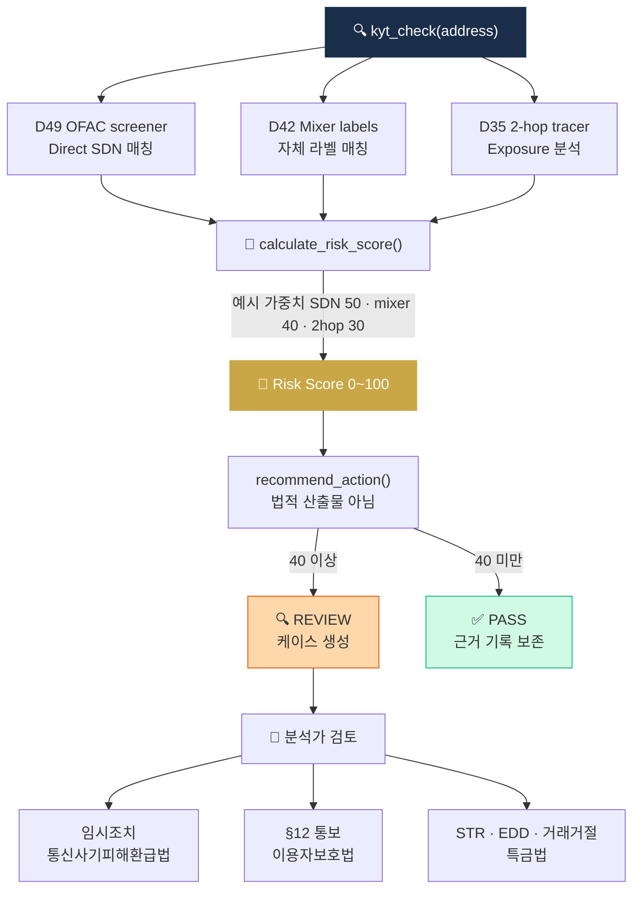
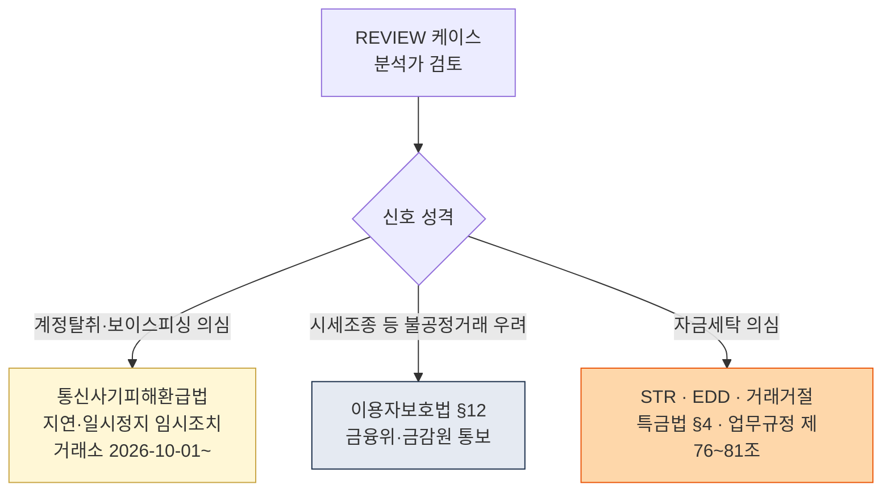

# Project 05 — KYT API 호출 Wrapper

> 자체 또는 외부 KYT를 통합 인터페이스로. (D56 미니 프로젝트) 마지막 업데이트: 2026-10-21.

> 용어: "KYT"는 업계 용어이며 FATF·MAS·한국 고시 어디에도 나오지 않습니다. 규범 문언은 "transactions monitoring and blockchain analytics tools"(FATF 7차 TU), "거래모니터링체계"(FIU 업무규정 제76~81조)입니다.


> **상태**: 스펙 작성 완료 (README.md만 존재, `main.py` 미작성 — 학습자 구현 대상)
> **위치**: `projects/05-kyt-wrapper/` (예정: README.md + main.py + test.py + sample_outputs/)
> **예상 구현 시간**: 주말 2일

## 🏗 아키텍처



## 왜 이걸 만드나

앞서 만든 **D42(mixer)·D49(OFAC)·D35(tracer)** 가 각기 따로 작동하던 것을, 하나의 `kyt_check(address)` 함수로 **통합**하는 프로젝트. Risk Score를 계산하고 사람 검토로 보낼지(REVIEW) 말지(PASS)를 추천하는 구조를 만들면, Capstone에서 설계할 Risk Engine의 **핵심 로직**이 이미 구현된 상태로 도착합니다. 6개 프로젝트 중 **가장 통합적이고 실무에 가까운** 산출물.

## 학습 목표

1. KYT API 통합 패턴 익히기
2. Risk Score 계산 (자체 또는 벤더 결과 종합)
3. Action 추천 (PASS / REVIEW) — 법적 산출물이 아니라 검토 큐 진입 여부
4. 이전 프로젝트 (D42 mixer + D49 OFAC + D35 tracer) 결합

## 사양

### 입력
- 가상자산 지갑주소 1개

### 출력
```json
{
  "address": "0xABC...",
  "risk_score": 75,
  "risk_categories": ["mixer_exposure", "sanctions_2hop"],
  "exposure": {
    "direct": [
      {"address": "0xTornado...", "label": "tornado-cash", "tx_count": 3}
    ],
    "indirect_2hop": [
      {"address": "0xSDN...", "label": "OFAC SDN (예시)", "via": "0xMid..."}
    ]
  },
  "recommended_action": "REVIEW",
  "checked_at": "2026-10-21T10:00:00Z"
}
```

## 인터페이스

```python
def kyt_check(address: str) -> dict:
    """통합 KYT 체크"""
    # 1. OFAC 매칭 (D49)
    sdn = ofac_screener.screen(address)
    
    # 2. 자체 라벨 매칭 (D42 mixer 등)
    labels = local_label_match(address)
    
    # 3. Exposure 분석 (D35 trace)
    trace = onchain_tracer.trace_two_hop(address)
    
    # 4. Risk Score 계산
    score = calculate_risk_score(sdn, labels, trace)
    
    # 5. Action 추천
    action = recommend_action(score)
    
    return { ... }

def calculate_risk_score(sdn, labels, trace) -> int:
    """0~100 점수 — 아래 가중치는 학습용 예시값(업계 표준 아님)"""
    # Direct SDN: +50
    # Direct mixer: +40
    # 2-hop SDN: +30
    # 2-hop mixer: +20

def recommend_action(score: int) -> str:
    """"PASS" | "REVIEW" — 법적 산출물 아님. BLOCK은 내지 않는다.
    REVIEW 케이스는 분석가 검토 뒤 임시조치 / §12 통보 / STR·EDD·거래거절 중 하나로 간다."""
    if score >= 40: return "REVIEW"
    return "PASS"
```

## 옵션 — 외부 API

학습용 무료/저비용:
- **Bitquery** (GraphQL, 무료 티어) — https://bitquery.io
- **AMLBot** — 일부 무료
- **Etherscan + 자체 라벨** — 가장 단순

## 테스트 케이스

1. 정상 wallet → PASS
2. Tornado 직접 노출 → REVIEW (믹서 노출 +40. Tornado Cash는 2025-03-21 SDN에서 삭제됐으므로 제재 근거가 아니라 믹서 위험 신호로 채점)
3. 2-hop OFAC SDN 노출 → REVIEW (제재 대상 일치 여부는 분석가가 확인, 일치 시 제재 이행 절차)
4. 라벨 없는 신규 wallet → PASS (근거 기록 보존)
5. 한국 거래소 hot wallet → PASS + 라벨 표기
6. 어떤 점수에서도 `BLOCK`이 반환되지 않는지 확인 (enum은 PASS · REVIEW 둘뿐)

## 산출물

```
05_kyt_wrapper/
├── README.md
├── main.py
├── test.py
├── requirements.txt
├── sample_results/
│   ├── normal_wallet.json
│   ├── mixer_exposed.json
│   └── sdn_2hop.json
└── .env.example
```

## 💼 실무 현장 (Industry Reality)

### 점수 하나, 법적 출구는 셋

이 프로젝트의 `recommend_action()`은 PASS/REVIEW, 즉 사람 검토로 보낼지 여부까지만 정합니다. 법적 산출물은 REVIEW 케이스를 분석가가 검토한 뒤 아래 세 갈래 중 하나로 결정합니다. wrapper가 이 셋을 직접 내지 않게 하세요.



- **wrapper는 BLOCK을 내지 않는다**: 이용자보호법 §11은 정당한 사유 없는 입출금 차단을 금지합니다. 차단·지연은 통신사기피해환급법 임시조치 절차(통지·본인확인·해제·기록 보존) 등 근거를 갖춰야 합니다([법제처 통신사기피해환급법](https://www.law.go.kr/LSW/lsInfoR.do?lsiSeq=290245&efYd=20261002&ancYnChk=0&chrClsCd=010202&urlMode=lsInfoR); [`../../notes/2-regulations/korea-user-protection.md`](../../notes/2-regulations/korea-user-protection.md)).
- **STR은 자동 판정이 아니다**: FATF 2021 가이던스 para 275~276은 자동화와 함께 "flagged transactions should go through human/expert analysis"를 요구합니다. 2027-02-19부터 1천만원 이상 거래에 요구되는 것도 "자체 의심거래 감시체계 구축·운영"이지 자동 STR이 아닙니다(시행령 §10의20 ⑦나, 고시 §28-2③).
- **발행자 동결에 기대지 말 것**: FATF 7차 TU(para 35)는 VASP가 "issuer-level asset freeze/burn mechanisms"를 준수 안전장치로 믿을 수 없을 수 있다고 했고, 학계는 USDT 제재 주소의 7.3%, USDC의 18.7%가 동결 발효 전에 전액 인출됐다고 측정했습니다([arXiv 2603.27739](https://arxiv.org/abs/2603.27739)).

### 프로덕션과의 차이 (정성 비교)

| 항목 | 이 프로젝트(학습용) | 운영에서 추가로 필요한 것 |
|---|---|---|
| 호출 방식 | 동기 함수 | 이벤트 스트리밍 |
| Risk Score | 고정 가중치 룰 | 룰 + 벤더 점수 조합 — 업계 구성 비율의 공개 근거 없음 |
| 출력 | 단일 action | 위 세 갈래 법적 출구 + 케이스 관리 |
| 장애 대응 | 없음 | 벤더 장애 시 사전 정의된 축소 운영 정책 |

### 벤더·운영 지표에 대해

블록체인 분석 벤더가 공개하는 커버리지·노출도 산정 방식·지연 시간은 모두 자사 주장(T5)이라 이 저장소는 인용하지 않습니다. 가상자산 전용 alert-to-STR 공개 벤치마크도 존재하지 않습니다(은행권 자료로는 EY 2018 리테일 평균 14%만 있음, B)([EY 2018](https://ey.com/content/dam/ey-unified-site/ey-com/en-uk/industries/financial-services/documents/ey-anti-money-laundering-transaction-monitoring-2018-emeia-survey.pdf)). 이전 판의 지연·가용성·FP 비율·알람 볼륨·단가·벤더 가격·벤더 구성 서술은 출처가 없어 삭제했습니다(공개 근거 없음).

### 배포·운영 팁

- **웹훅 수신 멱등성**: 같은 alert id 중복 수신에 대비해 idempotent하게 처리하세요.
- **가중치 튜닝**: 가중치를 바꿀 때는 변경 이력·승인 기록을 남기고 한 번에 한두 개씩 바꾸세요. FATF 2021 가이던스는 운영 룰의 무결성을 "regular basis"로 검증하라고 합니다.
- **Exposure 정의 정규화**: direct/indirect의 경계는 벤더마다 다릅니다. 사내 스키마로 정규화하세요.
- **벤더 장애 정책**: 분석 API가 다운될 때 어떤 거래를 보류하고 어떤 거래를 사후 재검증할지 사전에 문서화하세요(금액 기준은 각 회사 위험평가로 정함 — 공개된 업계 관행 수치 없음).
- **STR 연계**: 높은 점수는 케이스 큐에 올리고, 분석가 검토와 보고책임자 결재를 거쳐 FIU에 보고합니다.

## 학습 자료

- [`../../notes/4-technology/kyc-kyt.md`](../../notes/4-technology/kyc-kyt.md) — KYT
- [`../../notes/4-technology/blockchain-analytics.md`](../../notes/4-technology/blockchain-analytics.md) — Exposure
- [`../../notes/7-vendors/analytics-vendors.md`](../../notes/7-vendors/analytics-vendors.md) — 벤더 비교

## 한계 / 주의

- **자체 KYT는 글로벌 attribution 절대 부족**
- 프로덕션 = Chainalysis/TRM/Elliptic + 자체 보완 하이브리드
- Risk Score 가중치는 회사/규제마다 다름 (튜닝 필수)
- False positive 처리 워크플로 필수

## 보너스 챌린지

- 결과를 STR 후보 큐에 자동 추가
- 일일 알람 보고서
- 다중 체인 통합 (BTC + ETH + Tron)
- Webhook 알림
- 분석 대시보드 (Streamlit)
