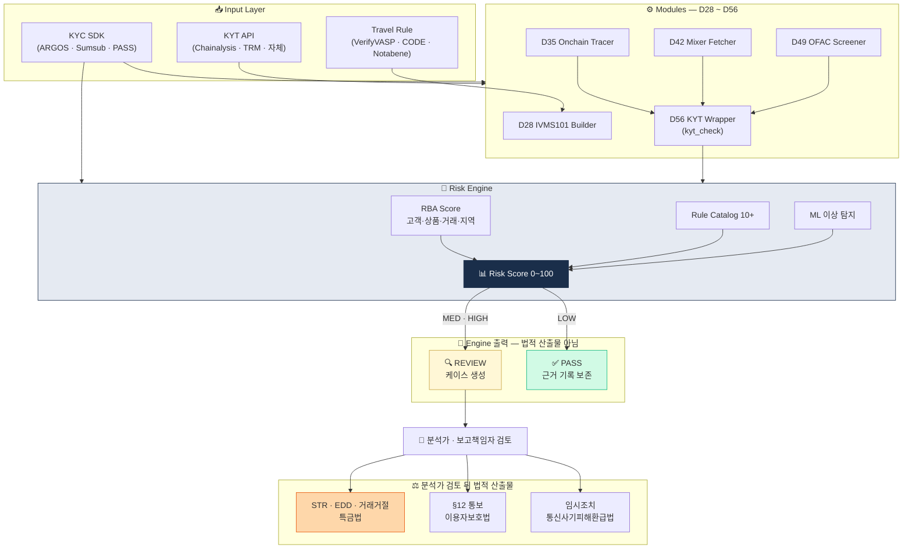
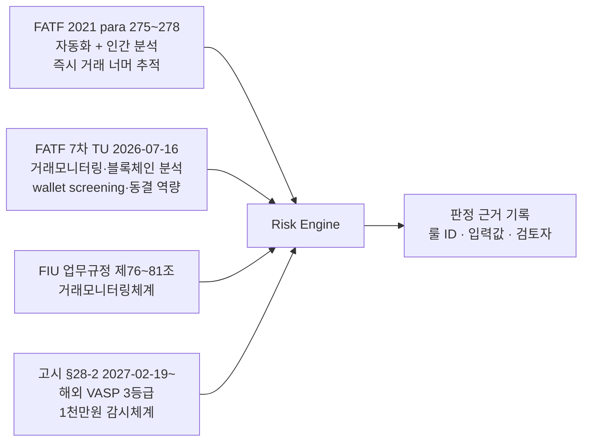

# Capstone — Mini AML Risk Engine 설계서

> 60일 학습 통합. 가상자산 거래소·수탁용 통합 위험엔진의 1차 설계 문서. (D59 캡스톤) 마지막 업데이트: 2026-10-21.

> ⚠️ 이 파일은 **템플릿** 입니다. D59 캡스톤 작업 시 본인이 직접 채워서 완성하세요.


> **상태**: 스펙(설계서 템플릿) 작성 완료. 구현 코드 없음 — D59 캡스톤에서 학습자가 01~05 프로젝트를 통합해 작성.
> **위치**: `projects/06-capstone-risk-engine/` (DESIGN.md만 존재)
> **예상 구현 시간**: 2주

## 🏗 Capstone 통합 아키텍처



> Engine 출력은 `PASS` | `REVIEW` 두 값뿐이며 법적 산출물이 아닙니다(D56 KYT Wrapper와 같은 enum, BLOCK 없음). 등급 경계는 학습용 예시입니다. REVIEW 케이스는 사람 검토 뒤 세 법적 출구 중 하나로 갑니다 — ① 통신사기피해환급법 임시조치(FDS, 거래소 2026-10-01~), ② 가상자산이용자보호법 §12 시장감시 통보, ③ 특금법 STR·EDD·거래거절. 설계서 2절 매핑에서 이 셋을 구분하세요.

## 캡스톤의 목적

60일 동안 배운 **9 의무·RBA·KYT·Travel Rule·제재·STR·거버넌스** 를 하나의 시스템 설계서로 묶는 작업. 단순히 기능을 나열하는 게 아니라, **한국 규제(특금법 §·이용자보호법 §) → 시스템 모듈 → 운영 절차**가 추적 가능하도록 연결합니다. 이 문서가 완성되면 실제 VASP 설립 시점에 **법무팀·컴플팀·엔지니어팀이 공통 참조할 수 있는 1차 설계서**가 됩니다.

## 왜 이게 중요한가

글로벌 VASP의 AML 사고 대부분은 "각 조각은 있는데 통합이 없다"에서 출발합니다. KYC는 A팀, KYT는 B팀, Travel Rule은 C팀이 각자 별도로 운영하면 고객 위험이 **전체적으로 합산되지 않습니다**. Capstone은 이 통합을 **문서 레벨**에서라도 먼저 만들어보는 훈련. 추후 90일 로드맵(D60)에서 이 설계서가 실제 프로토타입으로 발전할 수 있습니다.

---

# Mini AML Risk Engine — Design Document

## 1. 문제 정의
<!-- 풀려는 문제 / 사업유형 / 성공 기준 -->

### 시나리오
> 예: "한국 가상자산 거래소가 기관 고객 신규 온보딩 시, KYC + KYT를 통합한 자동 위험평가 시스템 필요"

### 사업유형
- [ ] 거래소
- [ ] 수탁업
- [ ] OTC desk
- [ ] 결제 PG
- [ ] 솔루션 제공사

### 성공 기준 (본인 설정 목표값 — 업계 공개 벤치마크 아님)
- 정확도 (true positive rate ≥ X%)
- 속도 (응답 ≤ X초)
- False positive ≤ X%
- 참고: 극단적 불균형 데이터에서는 F1만 보면 오독한다 — Elliptic2의 GLASS는 F1 0.933이지만 PR-AUC 0.208(B)([arXiv 2404.19109](https://arxiv.org/abs/2404.19109)). PR-AUC 등을 함께 보고할 것

---

## 2. 적용 규제 매핑

### 한국
| 의무 | 법령 § | 시스템 어디서 충족 |
|---|---|---|
| 신원확인 | 특금법 §5의2 | KYC 모듈 |
| 실소유자 | 특금법 §5의2 | KYC 모듈 |
| EDD | 특금법 §5의2 + FIU 업무규정 | Risk Engine |
| 거래모니터링 | FIU 고시 「자금세탁방지 업무규정」 제76~81조(2026-01-22 시행) | KYT·룰 엔진 |
| Travel Rule (~2027-02-18) | 특금법 §5의3 + 시행령 §10의10 — **100만원 이상** | Travel Rule 모듈 |
| Travel Rule (2027-02-19~, enacted-not-in-force) | 시행령 §10의10·§10의20 + FIU 고시 §28-2 — **기준금액 없이 전건**, 해외 VASP 3등급, 자기수탁 주소는 동일인만, 1천만원 이상 **자체 의심거래 감시체계**(자동 STR 아님) | Travel Rule 모듈 + 상대방 위험평가 |
| STR | 특금법 §4 | STR 검토 큐 |
| 보이스피싱 임시조치(FDS) | 통신사기피해환급법 §2의5(거래소 2026-10-01 시행) | FDS 모듈 (별도 축) |
| 이용자 자산 보호 | 이용자보호법 §6~§9 | (별도, 위탁·보관 시스템) |
| 불공정거래 감시 | 이용자보호법 §10(금지)·§12(이상거래 상시감시), 시행령 §18 | (별도, Market Surveillance → 금융위·금감원 통보) |
| 입출금 차단 제한 | 이용자보호법 §11, 시행령 §17 | 차단·보류 정책 |
| 기록보관 | 특금법 + 이용자보호법 시행령 §13 — 기간은 원문 확인, 겹치면 긴 쪽 | 보존 정책 |

근거: [대통령령 제36592호 시행예정 판본](https://www.law.go.kr/DRF/lawService.do?OC=test&target=eflaw&MST=288765&efYd=20270219&type=XML), [FIU 고시 제2026-2호](https://www.law.go.kr/DRF/lawService.do?OC=test&target=admrul&ID=2100000285986&type=XML), [가상자산이용자보호법](https://www.law.go.kr/LSW/lsInfoR.do?lsiSeq=290735&efYd=20261002&ancYnChk=0&chrClsCd=010202&urlMode=lsInfoR), [통신사기피해환급법](https://www.law.go.kr/LSW/lsInfoR.do?lsiSeq=290245&efYd=20261002&ancYnChk=0&chrClsCd=010202&urlMode=lsInfoR). 이전 판의 "Travel Rule 특금법 §5의2", "기록보관 이용자보호법 §11·DB 15년"은 틀려 고쳤습니다. §28-2의 정확한 시행일은 기산점 문제로 확정되지 않았습니다.

### 글로벌 (해외 영업 시)
- FATF R.15/INR.15 §7(b)(가상자산 트래블룰의 원천, 2019-06). 2025-06 개정 R.16은 VASP에 R.15를 거쳐 간접 적용, de minimis는 USD/EUR 1,000 이하, 이행 기대시한 2030년 말
- US: OFAC SDN, BSA 31 CFR 1010.410(f) "$3,000 or more"
- (해당 시) EU TFR(2024-12-30 적용, 금액 무관 전건, 자기수탁 EUR 1,000 이상 소유·통제 검증), AMLR(2027-07-10 적용 예정)
- (해당 시) 영국 MLR reg 64C — 2026-06-30부터 £800

---

## 3. 데이터 소스

> 제품명은 해당 기능을 공개적으로 표시한 예시이며 우열·점유율 평가가 아닙니다.

| 영역 | 1순위 | 2순위 |
|---|---|---|
| **본인확인** | PASS / NICE / KCB / 카카오 | — |
| **KYC SDK** | (예) ARGOS / ICONLOOP / Sumsub | — |
| **PEP / Sanctions** | World-Check / ComplyAdvantage | 한국 외교부 자체 |
| **Adverse Media** | RDC / ComplyAdvantage | — |
| **KYT (Blockchain)** | Chainalysis / TRM / Elliptic | 자체 한국 라벨 |
| **OFAC SDN Crypto** | OFAC 직접 + 벤더 | — |
| **Travel Rule** | (예) VerifyVASP / CODE / GTR / TRP·TRISA | — |
| **국가 위험** | FATF / 외교부 / Basel | — |

---

## 4. 시스템 아키텍처

```
[ User Onboarding ] ────► [ KYC SDK ]
                              │
                              ▼
                       [ Risk Engine ]
                       ├─ KYC Risk
                       ├─ KYT Exposure
                       ├─ Sanctions Match
                       ├─ Behavior Pattern
                       └─ → Risk Score
                              │
              ┌───────────────┴───────────────┐
              ▼                               ▼
          [ PASS ]                       [ REVIEW ]  ← Engine 출력은 여기까지 (법적 산출물 아님)
       (근거 기록 보존)                        │
                                              ▼
                                [ 분석가 · 보고책임자 검토 ]
                          ┌───────────────┼───────────────┐
                          ▼               ▼               ▼
                     [ 임시조치 ]     [ §12 통보 ]   [ STR · EDD · 거래거절 ]
                 (통신사기피해환급법) (이용자보호법)    (특금법 → FIU)

[ Transaction ] ───► [ KYT real-time ]
                          ├─ Address Screening
                          ├─ Exposure Score
                          ├─ Travel Rule (~2027-02-18 100만원 이상 / 2027-02-19~ 전건)
                          └─ Sanctions Check
                              │
                              ▼
                          [ Decision ]
```

---

## 5. Risk Score 모델

### 입력 변수 (가중치는 학습용 예시값)
| 변수 | 가중치 | 출처 |
|---|---|---|
| KYC 위험 (PEP, 고위험국) | 30 | KYC + DB |
| KYT 직접 노출 (mixer/SDN) | 40 | KYT API |
| KYT 2-hop 노출 | 20 | KYT API |
| 거래 패턴 (smurfing 등) | 10 | 자체 룰 |

### 등급 매핑
- 0~30: LOW → `PASS` (근거 기록 보존)
- 31~70: MEDIUM → `REVIEW` (일반 우선순위)
- 71~100: HIGH → `REVIEW` (최우선 — 법적 산출물은 분석가·보고책임자 판단)

---

## 6. 룰 카탈로그 (최소 10개)

| ID | 트리거 | Action |
|---|---|---|
| R001 | OFAC SDN 직접 매칭 | REVIEW 최우선 → 제재 대상 일치 확인 시 제재 이행 절차·STR 검토 |
| R002 | Tornado Cash 노출 (1-hop) | REVIEW — 2025-03-21 SDN 삭제로 제재 근거 아님, 믹서 위험 신호 |
| R003 | 알려진 mixer 노출 (1-hop) | REVIEW |
| R004 | OFAC SDN 2-hop | REVIEW |
| R005 | Smurfing 패턴 (10회+ in 24h) | REVIEW |
| R006 | Pass-through (입금 → 5분 내 전액 출금) | REVIEW |
| R007 | PEP 신규 가입 | REVIEW → EDD 검토 |
| R008 | 고위험국 거주 | REVIEW → EDD 검토 |
| R009 | 신고 직업 vs 거래 금액 30배+ 불일치 | REVIEW |
| R010 | 비정상 시간대 (UTC 03~05) 대량 거래 | REVIEW |
| R011 | (2027-02-19~) 1천만원 이상 해외 VASP·자기수탁 주소 이전 | REVIEW — 자체 의심거래 감시체계 검토 (자동 STR 아님) |
| R012 | (2027-02-19~) 자기수탁 주소로의 이전, 동일인 확인 안 됨 | REVIEW — 고시 §28-2상 이전 제한 대상인지 확인 (Engine이 직접 차단하지 않음) |

> R001~R010의 임계값(10회, 5분, 30배 등)은 학습용 예시입니다. FATF Red Flag(2020-09-14)는 지표 하나만으로 의심 근거가 되지 않으며 감독 체크리스트로 쓰지 말라고 명시합니다(para 8·20)([Red Flag PDF](https://www.fatf-gafi.org/content/dam/fatf-gafi/reports/Virtual-Assets-Red-Flag-Indicators.pdf)).

---

## 7. 운영 플로우

(생략 — 본인이 채움)

---

## 8. 거버넌스

### 5 Pillars 매핑
- 정책: AML 매뉴얼 + 룰 카탈로그
- AMLO: ___ (임원 직책)
- 교육: ___
- 감사: 내부감사 연 1회 + 외부 ___
- CDD/BO: KYC SDK + 25% BO 룰

### 3LoD
- 1선: 영업/CS
- 2선: 컴플라이언스 (Risk Engine 운영)
- 3선: 내부감사

---

## 9. 단계적 도입 로드맵

| 단계 | 기간 | 산출물 |
|---|---|---|
| MVP | 3개월 | KYC + 기본 KYT + Sanctions |
| v1 | 6개월 | + 룰 엔진 + STR 자동화 |
| v2 | 12개월 | + ML 보조 + Cross-chain + Travel Rule 풀스택 |

---

## 10. 리스크와 한계

- False positive: ___% 예상, 운영 비용
- 자체 KYT 한계: 글로벌 attribution은 벤더 의존
- DeFi / Privacy coin 영역은 별도 정책 필요
- 인력: AMLO 1명 + 분석가 ___명 (참고: 2026-08-13 개정 신고매뉴얼은 AML 인력 4인 이상을 요구 — [금융위 2026-08-13](https://www.fsc.go.kr/no010101/87521))

---

## 11. 참고 (60일 학습 자료 인용)

- [`../../notes/1-foundations/`](../../notes/1-foundations/) — AML 기초
- [`../../notes/2-regulations/korea-fiu-act.md`](../../notes/2-regulations/korea-fiu-act.md) — 특금법
- [`../../notes/2-regulations/korea-user-protection.md`](../../notes/2-regulations/korea-user-protection.md) — 이용자보호법
- [`../../notes/3-crypto-aml/travel-rule.md`](../../notes/3-crypto-aml/travel-rule.md) — Travel Rule
- [`../../notes/4-technology/kyc-kyt.md`](../../notes/4-technology/kyc-kyt.md) — KYC/KYT
- [`../../notes/5-compliance/`](../../notes/5-compliance/) — 컴플 운영
- [`../../notes/7-vendors/`](../../notes/7-vendors/) — 솔루션 벤더
- [`../../notes/6-cases/`](../../notes/6-cases/) — 사례
- [`../../deep/`](../../deep/) — 학술/리서치
- [`../01-ivms101-builder/`](../01-ivms101-builder/) — Travel Rule 빌더
- [`../02-onchain-tracer/`](../02-onchain-tracer/) — Onchain trace
- [`../03-mixer-fetcher/`](../03-mixer-fetcher/) — Mixer DB
- [`../04-ofac-screener/`](../04-ofac-screener/) — OFAC 스크리너
- [`../05-kyt-wrapper/`](../05-kyt-wrapper/) — KYT wrapper

---

## 💼 실무 현장 (Industry Reality)

### 공개 규범이 Risk Engine에 요구하는 것



- 지속 모니터링은 자동화와 사람의 검토를 함께 요구하고, 운영 룰의 무결성을 "regular basis"로 검증해야 합니다(FATF 2021 para 275~276)([FATF 2021 RBA 가이던스](https://www.fatf-gafi.org/content/dam/fatf-gafi/guidance/Updated-Guidance-VA-VASP.pdf.coredownload.pdf)).
- 7차 TU는 통제 요소로 "KYC, wallet screening, blacklisting, and, where appropriate, whitelisting mechanisms as well as freezing and blocking capabilities"를 열거하고, 소매 사용자로 위장한 역외 VASP 계정 탐지와 브리지·믹서·크로스체인 노출 평가를 요구했습니다(권고 5-ii, 6-iii·iv)([7차 TU PDF](https://www.fatf-gafi.org/content/dam/fatf-gafi/reports/7th-targeted-update-on-implementation-fatf-standards-vas-vasps-2026.pdf.coredownload.pdf)).
- 2024-08-22 금융위·금감원 현장점검에서 확인된 거래소 시장감시 시스템은 가격상승률·거래량증가율 같은 변수의 임계값으로 적출하는 **룰 기반 자체 개발 시스템**이었습니다([금융위·금감원 2024-08-22](https://fsc.go.kr/po010101/82943)). 이것은 §12 시장감시 쪽이며 AML 거래모니터링과 다른 축입니다.

### 공개 근거가 없어 삭제한 것

이전 판에 있던 특정 거래소의 내부 구조·룰 개수·사내 모델명, 자체 구축 판단 기준 금액, STR 전환율·처리시간·커버리지·감사 지적 건수 같은 KPI, 인력·연봉 수치는 1차 출처가 없어 삭제했습니다(공개 근거 없음). 거래모니터링 알람→STR 전환율의 공개 벤치마크는 은행권 자료(EY 2018, 리테일 평균 14%, B)만 있고 가상자산 전용 벤치마크는 없습니다([EY 2018](https://ey.com/content/dam/ey-unified-site/ey-com/en-uk/industries/financial-services/documents/ey-anti-money-laundering-transaction-monitoring-2018-emeia-survey.pdf)).

### ML을 넣을 때 참고할 공개 연구

- Weber 외(2019) Elliptic 데이터셋에서 랜덤포레스트(F1 0.796)가 GCN(F1 0.628)보다 나았고, 다크마켓 폐쇄 이후 모든 모델 성능이 급락했습니다(B)([arXiv 1908.02591](https://arxiv.org/abs/1908.02591)).
- Elliptic 시계열 분할에서 Extra Trees(AUPRC 0.570)가 GraphSAGE(0.311)를 앞섰습니다(B)([Akter 외 2026](https://publications.eai.eu/index.php/airo/article/download/13658/4313/36724)).
- 근거 인용을 강제한 LLM 알람 트리아지 연구는 인용 유효성 0.98, 에스컬레이션 F1 0.62였고 합성 데이터 평가였습니다([arXiv 2604.19755](https://arxiv.org/abs/2604.19755)). 근거를 잘 인용한다고 판단이 맞는 것은 아닙니다.

### 배포·운영 팁

- **규제 추적성**: 각 룰이 어떤 법령·FATF 문서에 대응하는지 메타데이터로 태깅하세요. 예: "R005 → 특금법 §4·업무규정 제76~81조, Red Flag 거래패턴 범주".
- **법적 출구 태깅**: 각 룰의 산출물이 FDS 임시조치 / §12 통보 / STR 검토 중 무엇인지 함께 태깅하세요. 탐지 실패보다 분류 실패(틀린 출구로 보내는 것)가 더 위험합니다.
- **Shadow mode**: 신규 룰은 실제 차단 없이 로그만 남기며 운영해 FP를 분석한 뒤 확정하세요(기간은 각자 정함).
- **룰 변경 승인**: 룰 추가·삭제·튜닝은 정기 회의에서 승인하고 회의록을 감사 증거로 남기세요.
- **벤더 계약**: 벤더 API 의존 시 계약 갱신이 사업 연속성 리스크가 됩니다. 계약 조건을 법무와 검토하세요.

### 자주 나오는 오해

- **"Risk Engine = AML 전부"** — Risk Engine은 자동화 도구입니다. FATF 2021 가이던스도 플래그된 거래는 사람의 분석을 거치라고 합니다.
- **"Engine이 BLOCK을 내면 된다"** — Engine 출력은 PASS/REVIEW뿐입니다. 이용자보호법 §11은 정당한 사유 없는 입출금 차단을 금지하므로, 차단·지연은 임시조치·제재 이행·거래거절 중 어느 근거인지 사람이 정하고 그 절차를 따릅니다.
- **"1천만원 이상은 자동 STR"** — 2026-03-30 입법예고안의 내용이었고, 공포본은 "자체 의심거래 감시체계 구축·운영"입니다.

---

## 작성자 메모

캡스톤 후 [`../../curriculum/day_60.md`](../../curriculum/day_60.md) 의 90일 트랙 선택 → 이 설계서를 실제 프로토타입으로 발전.
