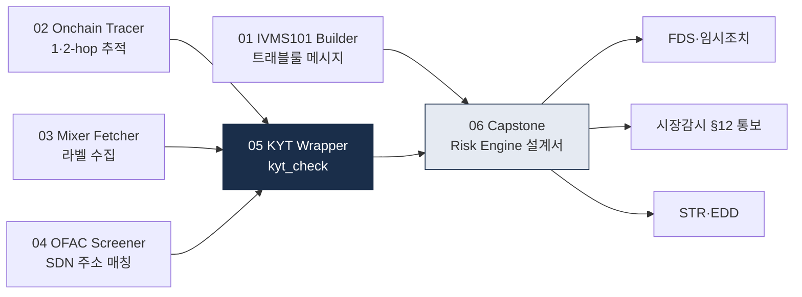

# 🛠️ projects — 자동화 미니 프로젝트

> 60일 챌린지의 **6개 미니 프로젝트** 코드 + 사양. 이 프로젝트들은 주별로 배운 개념을 **손으로 실행 가능한 코드**로 바꿔보고, 최종적으로 Capstone Risk Engine 설계서로 통합하기 위한 점진적 빌딩 블록입니다. 마지막 업데이트: 2026-10-21.

## 왜 코드까지 작성하나

법·규제·운영을 문서로 읽는 것과, **실제 OFAC SDN XML을 파싱해보고 Etherscan API로 2-hop 추적을 직접 해보는 것**은 이해의 깊이가 다릅니다. 6개 프로젝트는 난이도를 낮게 유지하되, Week 4~8 동안의 지식을 **손에 익도록** 반복시키는 것이 목적. 마지막 Capstone에서 이 6개가 하나의 시스템 설계도로 묶입니다.

## 프로젝트 목록

| 번호 | 폴더 | 주차 | 주제 |
|---|---|---|---|
| 01 | [`01-ivms101-builder/`](01-ivms101-builder/README.md) | W4 (D28) | IVMS101 메시지 빌더 + 검증 |
| 02 | [`02-onchain-tracer/`](02-onchain-tracer/README.md) | W5 (D35) | Etherscan API 2-hop tracer |
| 03 | [`03-mixer-fetcher/`](03-mixer-fetcher/README.md) | W6 (D42) | Mixer 주소 공개소스 fetcher |
| 04 | [`04-ofac-screener/`](04-ofac-screener/README.md) | W7 (D49) | OFAC SDN crypto wallet 스크리너 |
| 05 | [`05-kyt-wrapper/`](05-kyt-wrapper/README.md) | W8 (D56) | KYT API 호출 wrapper |
| 06 | [`06-capstone-risk-engine/`](06-capstone-risk-engine/DESIGN.md) | Capstone (D59) | Mini AML Risk Engine 설계서 |

## 프로젝트 상태 (2026-10-21 기준)

| # | 프로젝트 | 상태 | 난이도 | 예상 시간 |
|---|---|---|---|---|
| 01 | IVMS101 Builder | 스펙 | ⭐⭐ | 주말 1일 |
| 02 | Etherscan 2-hop Tracer | 스펙 | ⭐⭐⭐ | 주말 2일 |
| 03 | Mixer 주소 라벨 Fetcher | 스펙 | ⭐⭐ | 주말 1일 |
| 04 | OFAC SDN Crypto Screener | 스펙 | ⭐⭐ | 주말 1일 |
| 05 | KYT API Wrapper | 스펙 | ⭐⭐⭐ | 주말 2일 |
| 06 | Capstone — Mini Risk Engine | 스펙 | ⭐⭐⭐⭐⭐ | 2주 |

- **스펙**: README.md(또는 DESIGN.md)에 설계 완료, 실제 코드는 학습자가 직접 작성. 2026-10-21 기준 6개 모두 이 상태.
- **진행 중**: 일부 코드 구현, 미완성.
- **완료**: 동작 코드 + 테스트 + 예시 출력.

각 프로젝트는 학습 목적의 **참조 스펙**이며, 학습자가 직접 구현하는 과정에서 AML 기술을 체득합니다.

## 연결 구조 — 6개가 어떻게 합쳐지나



- **01~04**는 각기 **독립된 학습용 기능**을 구현합니다.
- **05 KYT Wrapper**에서 03(mixer)·04(OFAC)·02(tracer)를 조합해 `kyt_check(address)`라는 **통합 함수**를 만듭니다.
- **06 Capstone**은 여기까지 만든 코드 모듈을 엮어 **하나의 AML Risk Engine 설계서**로 결산합니다.

## 활용 가이드

### 학습 목적
- 코드 = 학습 도구. **프로덕션 코드 아님**
- 작동하는 데모 + 한계 인지가 목표
- 회사 컴플라이언스에 직접 사용 금지 (별도 검증 필수)

### 공통 환경
권장:
- Python 3.10+
- requests / pydantic / python-dotenv
- (선택) pandas / matplotlib / mermaid-py

```bash
pip install requests pydantic python-dotenv
```

### .env 패턴
모든 프로젝트는 API 키를 `.env`로 관리:

```bash
# .env (gitignore에 포함됨)
ETHERSCAN_API_KEY=your_key
OFAC_API_BASE=https://www.treasury.gov/ofac/downloads
```

### 폴더 구조 (공통)
```
0X_project/
├── README.md         # 사양 + 사용법
├── main.py           # 핵심 로직
├── test.py           # 테스트
├── requirements.txt  # 의존성
├── data/             # 산출물
├── sample_outputs/   # 예시
└── .env.example      # 환경변수 예시
```

## 안전 / 윤리

- **공개 데이터만 사용** — OFAC, 공개 블록체인, 공개 라벨 DB
- **API 호출 rate limit 준수**
- **PII 절대 저장 금지**
- **GitHub 푸시 전 .env 확인**

## 다음 단계 (60일 후)

캡스톤(D59) 후 90일 트랙 (D60) 에서 실제 프로토타입으로 발전 가능:
- 트랙 A (기술): 프로젝트 묶어서 통합 시스템
- 트랙 D (솔루션): MVP 기반 비즈니스 모델

## 💼 실무 현장 (Industry Reality)

### 6개 프로젝트가 대응하는 실무 기능

각 미니 프로젝트는 VASP 컴플라이언스 조직의 **한 기능**에 대응합니다. 오른쪽 열은 같은 기능을 제공한다고 공개적으로 표시한 제품의 예이며, 우열·점유율 평가가 아닙니다.

| 프로젝트 | 대응 실무 기능 | 공개된 유사 제품·표준의 예 |
|---|---|---|
| 01 IVMS101 Builder | 트래블룰 메시징 | TRP(OpenVASP Association 관리) · TRISA · 솔루션 네트워크(VerifyVASP · CODE · GTR · Sygna 등) |
| 02 Onchain Tracer | 조사(Investigation) | 블록체인 분석 벤더의 조사 도구 |
| 03 Mixer Fetcher | 라벨·위협정보 관리 | 분석 벤더 라벨 피드, 공개 OSINT |
| 04 OFAC Screener | 제재 스크리닝 | OFAC SDN 공식 데이터 + 워치리스트 스크리닝 제품 |
| 05 KYT Wrapper | 거래모니터링·블록체인 분석 통합 | 블록체인 분석 벤더 API |
| 06 Capstone Risk Engine | 컴플라이언스 전체 설계 | 케이스 관리·룰 엔진 제품 조합 |

### 규범이 요구하는 것 — 무엇을 자체로, 무엇을 벤더로 할지는 공개 근거 없음

- FATF 2021 RBA 가이던스 para 275~276은 지속 모니터링을 고객 프로파일 대비 거래 일관성 검증으로 정의하고, "automated systems may be the only realistic method of monitoring transactions, and flagged transactions should go through human/expert analysis"라고 합니다. para 277~278은 고위험 상황에서 모니터링을 "extend beyond the immediate transaction"하라고 요구합니다(02·05 프로젝트의 근거)([FATF 2021 RBA 가이던스](https://www.fatf-gafi.org/content/dam/fatf-gafi/guidance/Updated-Guidance-VA-VASP.pdf.coredownload.pdf)).
- FATF 7차 Targeted Update(2026-07-16)는 VASP에 "transactions monitoring and blockchain analytics tools"로 급속 이전을 탐지하라고 처음 권고했습니다(권고 6-ii)([7차 TU PDF](https://www.fatf-gafi.org/content/dam/fatf-gafi/reports/7th-targeted-update-on-implementation-fatf-standards-vas-vasps-2026.pdf.coredownload.pdf)).
- 한국 거래모니터링의 법적 근거는 FIU 고시 「자금세탁방지 업무규정」(제2025-2호, 2026-01-22 시행) 제76~81조이며, 본문에 "가상자산"이라는 단어는 없습니다([법제처 DRF](https://www.law.go.kr/DRF/lawService.do?OC=test&target=admrul&ID=2100000267264&type=XML)).
- 한국 거래소별로 어떤 기능을 자체 구축하고 어떤 벤더를 쓰는지는 이 저장소가 1차 근거로 확인하지 않았습니다. 이전 판의 "특정 거래소 실제 구성", "6개 중 4개 자체 구축이 업계 표준"은 근거가 없어 삭제했습니다. 공개된 것은 FIU 자신의 2026-02-05 업무계획에 "체이널리시스(가상자산 분석도구) 도입"이 들어 있다는 사실 정도입니다([금융위 2026-02-05](https://fsc.go.kr/no010101/86209)).

### 이 프로젝트와 프로덕션의 차이 (정성 비교)

| 항목 | 이 프로젝트 | 프로덕션에서 추가로 필요한 것 |
|---|---|---|
| 데이터 규모 | 수천 건 JSON | 스트리밍 처리, 재처리 파이프라인 |
| 지연시간 | 응답 수 초 OK | 출금 흐름을 막지 않는 응답 목표 — 수치 기준은 공개 근거 없음 |
| 라벨 DB | OFAC + 자체 수집 | 벤더 라벨(규모는 벤더 자사 주장, 미검증) + 자체 라벨 |
| 감사(Audit) | 없음 | 판단 결과·근거 보존 — 보존기간은 특금법·이용자보호법 원문 확인, 둘이 겹치면 긴 쪽 |
| 다중 체인 | ETH 단독 | 브리지·크로스체인 추적 |
| 법적 출구 | 단일 점수 | FDS·임시조치 / 이용자보호법 §12 통보 / 특금법 §4 STR 세 갈래 분리 |

마지막 행이 가장 중요합니다. 한국에서 "이상거래"는 ① 통신사기피해환급법(거래소 2026-10-01 시행)의 FDS·임시조치, ② 가상자산이용자보호법 §12 시장감시(금융위·금감원 통보), ③ 특금법 §4 의심거래보고(STR)를 각각 가리킵니다. Capstone 설계에서 이 셋을 하나의 BLOCK/STR 축으로 합치면 틀립니다.

### 이 프로젝트 6개를 포트폴리오로 쓸 때

GitHub에 공개한다면 README에 "학습용이며 실제 컴플라이언스 도구 아님"을 명시하고, OFAC SDN 데이터는 공개 데이터를 학습 목적으로 썼다는 점을 분명히 하세요.

## 참고

- 60일 커리큘럼: [`../curriculum/README.md`](../curriculum/README.md)
- 기술 기반: [`../notes/4-technology/`](../notes/4-technology/)
- 솔루션 시장: [`../notes/7-vendors/`](../notes/7-vendors/)
